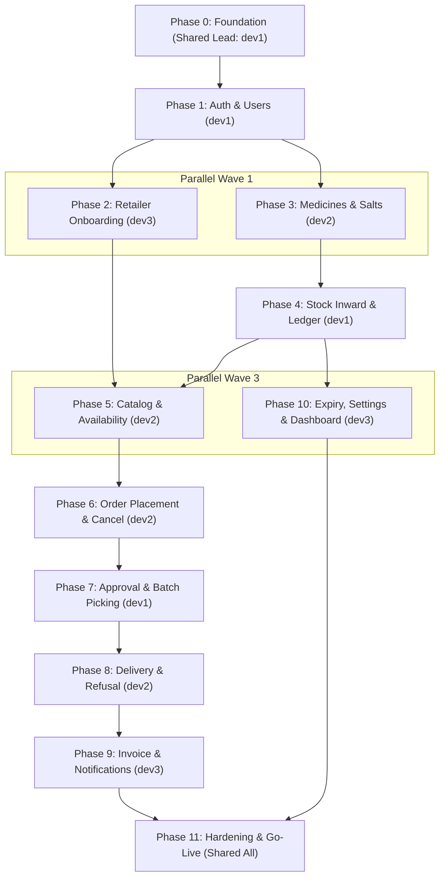

# KD-IOMS Project Roadmap & Developer Workstreams

**Baseline Architecture:** Twelve vertical phases (0 through 11) as specified in [`tech.md`](file:///d:/coding/Projects/kd-ioms/tech.md).  
**Engineering Branches:** `main`, `dev1`, `dev2`, `dev3`  
**Current Status:** Phase 0, Phase 1, Phase 3 & Phase 4 Completed & Verified; Phase 5 (Catalog) & Phase 10 (Expiry & Dashboard) Unblocked  

---

## 1. Roadmap Overview & Dependency Graph

---

## 2. Developer Allocation & Workstream Matrix

| Phase | Phase Name | Size | Developer | Nature of Work | Dependencies |
| :---: | :--- | :---: | :---: | :--- | :---: |
| **0** | **Foundation** | M | **Shared (Lead: dev1)** | **Shared Foundation** (Repo, tooling, config, schema baseline, CI) | None |
| **1** | **Auth and Users** | M | `dev1` | Core Security (Login, refresh, logout, password policies, user admin) | Phase 0 |
| **2** | **Retailer Onboarding** | S | `dev3` | Business Portal (KYC submission, review, approval gates) | Phase 1 |
| **3** | **Medicines and Salts** | M | `dev2` | Master Data (Salt trigram similarity, medicine master, sync trigger) | Phase 1 |
| **4** | **Stock Inward and Batches** | L | `dev1` | Inventory Core (Inward, batches, append-only ledger, scan screen) | Phase 3 |
| **5** | **Catalog and Availability** | S | `dev2` | Commerce Engine (Availability formula, price ceilings, catalog search) | Phase 4, Phase 2 |
| **6** | **Order Placement and Cancel** | M | `dev2` | Commerce Engine (Idempotency, reservation locks, cancellations) | Phase 5 |
| **7** | **Approval and Picking** | L | `dev1` | Warehouse Operations (FEFO allocation, batch scan resolve, partial pick) | Phase 6 |
| **8** | **Delivery, Refusal & Proof** | M | `dev2` | Field Logistics (Dispatch pool, atomic claim, photo proof, line refusal) | Phase 7 |
| **9** | **Invoice and Notifications** | L | `dev3` | Compliance & Comm (Single GST invoice, PDFKit, WhatsApp, Email failover) | Phase 8 |
| **10**| **Expiry, Settings & Dashboard**| S | `dev3` | Admin Operations (Alerts, threshold settings, removal write-offs, KPIs) | Phase 4 |
| **11**| **Hardening and Go-Live** | M | **Shared (All Devs)** | **Shared Integration** (OWASP security, rate limits, backups, Playwright E2E) | All (0–10) |

---

## 3. Phase Specifications & Acceptance Criteria

### Phase 0: Foundation
- **Goal:** Establish a deployable skeleton where all subsequent modules plug into identical conventions (envelope, errors, logging, DB pool, CI).
- **Responsible Developer:** **Shared Foundation (Lead: `dev1`, Reviewers: `dev2`, `dev3`)**
- **Main Deliverables:**
  - Express server with graceful shutdown (`src/server.js`, `src/app.js`).
  - Strict environment parser (`src/config/env.js`).
  - PostgreSQL connection pool & transaction manager with retry logic (`src/config/db.js`).
  - Standard error classes & PostgreSQL error mapping (`src/errors/*`, `src/utils/db-error-map.js`).
  - Structured request logging with AsyncLocalStorage request ID (`src/utils/request-context.js`).
  - Response envelope builder (`src/utils/response.js`).
  - Baseline migration runner & initial schema migration `001_init.sql` (schema v1.1).
  - Health endpoint `GET /api/v1/health`.
  - Next.js frontend scaffolding with TanStack Query, React Hook Form, and `/api/v1` rewrite.
  - GitHub Actions CI (lint, test, enum sync verification).
- **Automated Tests:**
  - `loadEnv` halts process on missing mandatory secrets.
  - `toPaise` and `fromPaise` round-trip accurately.
  - `withTransaction` retries serialization failures (`40001`, `40P01`) and rolls back on throws.
  - `errorHandler` hides SQL internals and returns uniform JSON envelope.
  - Integration: `GET /api/v1/health` returns standard envelope with `requestId`.
  - Integration: Route not found yields standard 404 envelope; malformed JSON yields 400.
- **Done When:**
  - `GET /api/v1/health` returns `{ success: true, code: "HEALTH_OK", ... }` via Vercel/Next rewrite.
  - Migrations execute cleanly on empty database.
  - Deliberately failed request displays reference ID in browser toast and server logs.

---

### Phase 1: Authentication and Users
- **Goal:** Admin can authenticate, provision retailer and delivery accounts, and enforce session security.
- **Responsible Developer:** `dev1`
- **Main Deliverables:**
  - Endpoints: `POST /auth/login`, `POST /auth/refresh`, `POST /auth/logout`, `POST /auth/change-password`, `GET /auth/me`.
  - Admin Endpoints: `POST /users`, `GET /users`, `GET /users/:userId`, `PATCH /users/:userId`, `POST /users/:userId/reset-password`.
  - Middleware: `authenticate.js`, `authorize.js`, `require-password-changed.js`.
  - Temporary password generation (shown once) & session tracking in `auth_sessions`.
  - Frontend auth provider, login page, change password page, admin user management screens.
- **Automated Tests:**
  - 5 consecutive invalid passwords lock account for 15 minutes; 6th attempt with valid password is rejected with `AUTH_ACCOUNT_LOCKED`.
  - Refresh token rotation works; replaying an old refresh token invalidates the entire session family.
  - Deactivated user's active JWT is immediately refused on subsequent primary-key DB check.
  - Password policy rejects passwords under 10 chars or lacking numbers/letters.
  - Retailer role attempting admin user routes receives 403 `FORBIDDEN`.
- **Done When:**
  - Admin signs in, creates a retailer, retailer logs in with temporary password, is forced to change it, and lands on retailer area.

---

### Phase 2: Retailer Onboarding
- **Goal:** Retailers submit KYC profile, admin reviews and approves/rejects, gating catalog access.
- **Responsible Developer:** `dev3`
- **Main Deliverables:**
  - Endpoints: `GET /retailers/me`, `PUT /retailers/me`, `GET /retailers`, `GET /retailers/:userId`, `POST /retailers/:userId/approve`, `POST /retailers/:userId/reject`.
  - Middleware: `require-approved-retailer.js`.
  - Retailer profile page with status banner (pending, approved, rejected with reason).
  - Admin review dashboard with Approve and Reject (reason dialog) actions.
- **Automated Tests:**
  - Profile submission transitions state to `PENDING`.
  - Admin approval changes status to `APPROVED`; rejection requires 5–300 char reason.
  - Unapproved or pending retailer accessing protected catalog/order routes receives 403 `RETAILER_NOT_APPROVED`.
  - Duplicate drug license number or GSTIN returns 409 `DUPLICATE_RESOURCE` targeting the field.
  - Direct edit on an `APPROVED` profile is refused.
- **Done When:**
  - Retailer moves from PENDING to APPROVED in UI and gated features unlock without app reload.

---

### Phase 3: Medicines and Salts Master
- **Goal:** Clean master catalog of salts and medicines preventing duplicates and typographical drift.
- **Responsible Developer:** `dev2`
- **Main Deliverables:**
  - Salt Endpoints: `GET /salts`, `GET /salts/suggest`, `POST /salts`, `PATCH /salts/:saltId`.
  - Medicine Endpoints: `POST /medicines`, `GET /medicines`, `GET /medicines/search`, `GET /medicines/:medicineId`, `PATCH /medicines/:medicineId`.
  - Trigram similarity matching via PostgreSQL `pg_trgm` (>0.5 threshold).
  - Automated database trigger updating `salts_text` on medicines upon salt rename.
  - Frontend salt management with type-ahead collision warning; medicine form with multi-salt chips.
- **Automated Tests:**
  - Exact salt duplicate (case-insensitive) rejected with 409 `DUPLICATE_RESOURCE`.
  - Similar salt (e.g. "Paracetamol 500" vs "Paracetamol") triggers `SALT_SIMILAR_EXISTS` unless `confirmSimilar: true`.
  - Medicine creation with unknown/inactive salt ID rejected.
  - Medicine creation enforces unique constraint across `(name, company, pack_size)`.
  - Deactivating a salt linked to active medicines returns 409 `SALT_IN_USE`.
  - Modifying medicine GST rate blocked if any batch selling price incl. GST exceeds MRP.
- **Done When:**
  - Admin creates multi-salt medicines and can search across name and salts via trigram index.

---

### Phase 4: Stock Inward, Batches and Append-Only Ledger
- **Goal:** Inward stock receipt by scan or manual entry, batch quantity tracking, and immutable ledger logging.
- **Responsible Developer:** `dev1`
- **Main Deliverables:**
  - Core function: `applyLedgerEntry()` in `stock-ledger.service.js`.
  - Endpoints: `POST /stock/inward`, `POST /stock/scan/resolve`, `GET /batches`, `GET /batches/:batchId`, `PATCH /batches/:batchId`, `POST /batches/:batchId/adjust`, `GET /stock/ledger`.
  - GS1 barcode and packaging OCR resolution utilities (`utils/gtin.js`, `parse-pack-text.js`).
  - Frontend inward screen (camera scanner, OCR capture, prefilled confirmation form), batch list, adjustment dialog.
- **Automated Tests:**
  - Concurrent inward calls for identical batch aggregate quantities correctly; no duplicate batch rows created.
  - Stock inward with expiry date in the past rejected with 422 `EXPIRY_IN_PAST`.
  - Stock inward where selling price incl. GST exceeds MRP rejected with 422 `PRICE_EXCEEDS_MRP`.
  - Stock adjustments (`DAMAGE`, `CORRECTION`, `EXPIRY_WRITEOFF`) require 5–300 char reason and generate corresponding ledger rows.
  - Direct SQL updates on `batches.quantity_on_hand` outside `applyLedgerEntry` blocked or prevented.
- **Done When:**
  - Stock received on mobile device via barcode/OCR/manual entry reconciles 100% with `batches.quantity_on_hand`.

---

### Phase 5: Catalog and Availability
- **Goal:** Aggregated medicine catalog with real-time sellable availability and price ceilings.
- **Responsible Developer:** `dev2`
- **Main Deliverables:**
  - Views: `v_catalog`, `v_medicine_availability`.
  - Endpoints: `GET /catalog`, `GET /catalog/:medicineId`, `GET /alerts/out-of-stock`.
  - Business rules: Max MRP and Max Price incl GST derived from active sellable batches; batch numbers/costs hidden from retailers.
  - Retailer catalog UI with debounced search, availability stepper, and cart persistence in local storage.
- **Automated Tests:**
  - Multiple active batches at different prices correctly expose the highest selling price incl. GST.
  - Expired and blocked batches are excluded from availability math.
  - Available quantity decrements when orders are in `PLACED` status and restores if cancelled.
  - Retailers in `PENDING` status receive 403 `RETAILER_NOT_APPROVED`.
- **Done When:**
  - Catalog reflects accurate availability for mixed stock (active, near-expiry, expired).

---

### Phase 6: Order Placement and Cancellation
- **Goal:** Retailer order placement with availability reservation, quote validation, and idempotency protection.
- **Responsible Developer:** `dev2`
- **Main Deliverables:**
  - Migration: `002_idempotency_keys.sql`.
  - Middleware: `middleware/idempotency.js`.
  - Endpoints: `POST /orders`, `GET /orders`, `GET /orders/:orderId`, `POST /orders/:orderId/cancel`.
  - State machine validation (`assertTransition` in `order.helpers.js`).
  - Document sequencing: `next_document_number('ORD')`.
  - Frontend cart checkout, order timeline (`OrderTimeline`), cancellation action.
- **Automated Tests:**
  - Concurrency test: Two simultaneous orders competing for remaining inventory results in exactly one success; the other receives 409 `INSUFFICIENT_STOCK`.
  - Idempotency test: Replay of same `Idempotency-Key` and body returns cached 200 response without creating duplicate order. Replay with modified body returns 409 `IDEMPOTENCY_KEY_REUSED`.
  - Order with price quote below current catalog price returns 409 `PRICE_CHANGED`.
  - Retailer cannot cancel order once moved out of `PLACED` status.
  - Retailer cannot view orders belonging to other pharmacies (tenant isolation).
- **Done When:**
  - Orders placed, safely retried, and cancelled with immediate availability adjustment.

---

### Phase 7: Order Approval and Batch Picking
- **Goal:** Admin picks real batches using FEFO suggestions, approves order with allocations, or rejects with restock.
- **Responsible Developer:** `dev1`
- **Main Deliverables:**
  - Endpoints: `GET /orders/:orderId/pick-suggestions`, `POST /orders/:orderId/approve`, `POST /orders/:orderId/reject`, `POST /batches/resolve-scan`.
  - FEFO (First Expiring, First Out) batch suggestion engine.
  - Atomic approval transaction: ascending batch locking, allocation creation, `OUTWARD` ledger entries, line fulfillment (`FULL`, `PARTIAL`, `NONE`), shortfall cancellation.
  - Rejection handler with automatic `RESTOCK` ledger entries for unclaimed approved orders.
  - Frontend admin picking interface with camera scanner and manual fallback.
- **Automated Tests:**
  - Picking an expired batch rejected with 422 `BATCH_EXPIRED`.
  - Picking a batch whose price incl. GST exceeds quoted price rejected with 422 `PRICE_EXCEEDS_QUOTE`.
  - Concurrent approval attempts on same order handled safely (first succeeds, second gets 409 `INVALID_STATE_TRANSITION`).
  - Partial fulfillment correctly marks line `PARTIAL` and cancels unallocated remainder.
  - Rejecting an approved unclaimed order returns stock to original batches with `RESTOCK` ledger rows.
- **Done When:**
  - Order transitions from PLACED to APPROVED in UI; batch stock reduced with full audit traceability.

---

### Phase 8: Delivery, Refusal and Proof
- **Goal:** Delivery partner claims orders from pool, delivers with photo proof, or refuses whole items on doorstep.
- **Responsible Developer:** `dev2`
- **Main Deliverables:**
  - Endpoints: `GET /delivery/pool`, `POST /delivery/orders/:orderId/claim`, `GET /delivery/orders`, `GET /delivery/orders/:orderId`, `POST /delivery/orders/:orderId/complete`.
  - Atomic claim logic via conditional SQL update.
  - Multipart upload for photo proof (5MB max) stored in Supabase Storage.
  - Line-level item refusal handler writing `RETURN_IN` ledger entries back to original batches.
  - Frontend delivery pool, active deliveries, and doorstep checklist with camera capture.
- **Automated Tests:**
  - Race condition test: 10 simultaneous claims on single order yields exactly 1 success; 9 receive 409 `ORDER_ALREADY_CLAIMED`.
  - Doorstep refusal of an item restores allocated batch quantity via `RETURN_IN` entries.
  - Order with 100% refused items marked `REJECTED` (no invoice generated).
  - Order with >= 1 accepted item marked `DELIVERED` and invokes invoice generation.
  - Non-assigned partner attempting to complete delivery receives 403 `FORBIDDEN`.
  - Failed photo upload aborts transaction without modifying order or stock status.
- **Done When:**
  - Full claim-to-delivery lifecycle executed on mobile viewport with accurate ledger updates.

---

### Phase 9: Invoicing and Multi-Channel Notifications
- **Goal:** Delivered orders generate numbered GST invoice PDFs, sent via WhatsApp with email fallback.
- **Responsible Developer:** `dev3`
- **Main Deliverables:**
  - Invoice sequence generation: `INV/YYYY-YY/00001` based on Indian fiscal year.
  - Single GST calculation and integer rupee rounding logic.
  - PDFKit template (`invoice.pdf.js`) uploaded to private Supabase bucket.
  - Meta WhatsApp Cloud API integration + Nodemailer SMTP fallback.
  - Endpoints: `GET /invoices`, `GET /invoices/:invoiceId`, `GET /invoices/:invoiceId/pdf`, `POST /invoices/:invoiceId/resend`.
  - Scheduled background worker `jobs/notification-retry.js` with exponential backoff.
- **Automated Tests:**
  - Fiscal year rollover: March 31 vs April 1 generates correct sequence prefix (`INV/2026-27/` vs `INV/2027-28/`).
  - Invoice tax calculation verifies single GST aggregate and rupee round-off.
  - Repeat delivery call does not create duplicate invoice.
  - Failed WhatsApp message automatically creates pending email dispatch log.
  - Notification retry worker terminates after 3 failed attempts.
  - Retailer cannot access invoice PDF of another pharmacy.
- **Done When:**
  - Delivery completion generates invoice PDF and logs WhatsApp/email dispatch within seconds; admin can resend.

---

### Phase 10: Expiry Alerts, Settings and Dashboard
- **Goal:** Daily operational alerts for expiring stock, physical write-off workflow, settings management, and KPI dashboard.
- **Responsible Developer:** `dev3`
- **Main Deliverables:**
  - Endpoints: `GET /alerts/near-expiry`, `GET /alerts/expired`, `POST /alerts/near-expiry/:batchId/dismiss`, `POST /batches/:batchId/remove-expired`, `GET /settings`, `PATCH /settings`, `GET /dashboard/summary`.
  - In-memory settings cache (60s TTL) with invalidation on update.
  - Parallel non-blocking dashboard summary queries.
  - Frontend admin dashboard count tiles, alerts tabs, and settings management form.
- **Automated Tests:**
  - Updating `expiry_alert_days` setting immediately adjusts near-expiry alert results.
  - Dismissing near-expiry alert removes batch from near-expiry view while keeping it visible in expired view once date passes.
  - Attempting to remove-expired a batch before its expiry date rejected with 409 `INVALID_STATE_TRANSITION`.
  - Dashboard summary counts reconcile 100% with underlying table totals.
- **Done When:**
  - Admin conducts full daily expiry and settings routine without manual database interventions.

---

### Phase 11: Hardening, Reliability and Go-Live
- **Goal:** Ensure system security, observability, disaster recovery, performance, and operational readiness.
- **Responsible Developer:** **Shared Integration (Lead: `dev1`, Reviewers/Integration: `dev2`, `dev3`)**
- **Main Deliverables:**
  - OWASP API Security Top 10 compliance audit.
  - Rate limiting enforcement (`middleware/rate-limit.js`).
  - Database query profiling (`EXPLAIN ANALYZE`) for catalog, orders, and pick suggestions.
  - Automated daily backup script and tested restore rehearsal.
  - Cold-start keep-warm ping for Render deployment.
  - Master data migration script `scripts/import-medicines.js` with dry-run mode.
  - Comprehensive Playwright end-to-end integration test suite.
  - Production deployment runbook & signed go-live checklist.
- **Automated Tests:**
  - OWASP Top 10 security verification suite.
  - Rate limiting tests (login threshold, general write threshold).
  - Playwright E2E full story test: onboard -> inward -> place order -> approve & pick -> claim -> deliver with refusal -> invoice generated.
- **Done When:**
  - E2E test passes on clean database in CI.
  - Restore rehearsal executed successfully on clean database instance.
  - Release checklist signed off by product owner.
