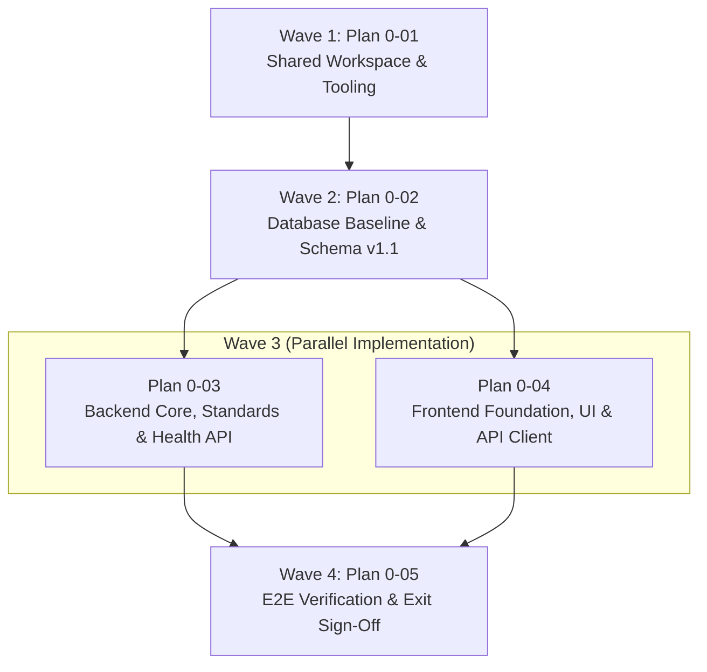

# Master Plan: Phase 0 — Foundation

**Phase:** Phase 0 — Foundation  
**Responsible Developer:** **Shared Foundation (Lead: `dev1`, Reviewers: `dev2`, `dev3`)**  
**Status:** Completed & Verified ✅  
**Primary Source:** [`tech.md`](file:///d:/coding/Projects/kd-ioms/tech.md) Section 5  
**Context:** [`.planning/phases/0-foundation/0-CONTEXT.md`](file:///d:/coding/Projects/kd-ioms/.planning/phases/0-foundation/0-CONTEXT.md)  

---

## 1. Wave Execution Structure

The implementation of Phase 0 is structured across 4 sequential and parallel waves:

---

## 2. Plan Breakdown Matrix

| Plan ID | Plan Title | Wave | Developer | Key Deliverables | Link |
| :---: | :--- | :---: | :---: | :--- | :--- |
| **`0-01`** | **Shared Workspace, Tooling & Root Orchestration** | 1 | Shared (`dev1`) | Root workspace `package.json`, orchestration scripts, shared enums in `backend/src/enums/`, enum sync script `sync-enums.ts`, CI workflow `.github/workflows/ci.yml`. | [`0-01-PLAN.md`](file:///d:/coding/Projects/kd-ioms/.planning/phases/0-foundation/0-01-PLAN.md) |
| **`0-02`** | **Database Baseline, Schema Migration v1.1 & DB Pool** | 2 | Shared (`dev1`) | Supabase PostgreSQL connection pool with retry/lock helpers (`config/db.ts`), migration runner (`db/migrate.ts`), baseline migration `001_init.sql` (schema v1.1 with all tables, triggers, views, functions). | [`0-02-PLAN.md`](file:///d:/coding/Projects/kd-ioms/.planning/phases/0-foundation/0-02-PLAN.md) |
| **`0-03`** | **Backend Core Foundation, Standards & Health API** | 3 | Shared (`dev1`) | Express app in TypeScript, Zod env parser, response envelope (`utils/response.ts`), `AppError` hierarchy, Pino request tracing (`X-Request-Id`), money/date utilities, middleware pipeline, health check endpoint `GET /api/v1/health`. | [`0-03-PLAN.md`](file:///d:/coding/Projects/kd-ioms/.planning/phases/0-foundation/0-03-PLAN.md) |
| **`0-04`** | **Frontend Foundation, Design System & API Client** | 3 | Shared (`dev1`) | Next.js rewrite proxy (`/api/v1/:path*`), typed API client (`lib/api/client.ts`), Query/Auth/Toast providers, lightweight custom Tailwind UI primitives, layout shells, role route groups (`auth`, `admin`, `retailer`, `delivery`). | [`0-04-PLAN.md`](file:///d:/coding/Projects/kd-ioms/.planning/phases/0-foundation/0-04-PLAN.md) |
| **`0-05`** | **E2E Verification & Health Integration** | 4 | Shared (`dev1`) | Live service verification via Next.js proxy, error reference ID tracing test (`Ref: <requestId>`), full workspace test execution (`npm test`), migration verification, Phase 0 exit sign-off. | [`0-05-PLAN.md`](file:///d:/coding/Projects/kd-ioms/.planning/phases/0-foundation/0-05-PLAN.md) |

---

## 3. Phase Exit Criteria ("Done When")

- [x] `GET /api/v1/health` returns standard envelope via Next.js rewrite (`localhost:3000/api/v1/health`).
- [x] Schema baseline `001_init.sql` applied cleanly on Supabase database.
- [x] Triggered error displays reference ID (`Ref: <requestId>`) in frontend toast and server logs.
- [x] Automated tests pass across backend and frontend workspaces (`npm test` - 23 passing tests).
- [x] Enum synchronization confirms zero drift between backend and frontend enums.
