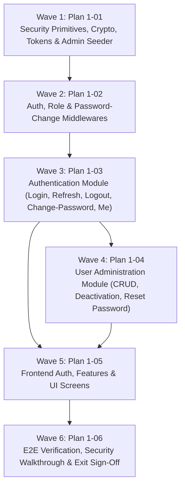

# Master Plan: Phase 1 — Authentication and Users

**Phase:** Phase 1 — Authentication and Users  
**Responsible Developer:** `dev1`  
**Status:** ✅ COMPLETED & VERIFIED  
**Primary Source:** [`tech.md`](file:///d:/coding/Projects/kd-ioms/tech.md) Section 6  
**Context:** [`.planning/phases/1-auth-users/1-CONTEXT.md`](file:///d:/coding/Projects/kd-ioms/.planning/phases/1-auth-users/1-CONTEXT.md)  

---

## 1. Wave Execution Structure

The implementation of Phase 1 is decomposed into 6 sequential and parallel waves:

---

## 2. Plan Breakdown Matrix

| Plan ID | Plan Title | Wave | Developer | Key Deliverables | Link | Status |
| :---: | :--- | :---: | :---: | :--- | :--- | :---: |
| **`1-01`** | **Security Primitives, Crypto, Tokens & Admin Seeder** | 1 | `dev1` | `bcryptjs` password hashing, timing-safe dummy verification, memorable passphrase generator, token utilities (`tokens.ts`), CLI admin seeder (`seed-admin.ts`), and unit tests. | [`1-01-PLAN.md`](file:///d:/coding/Projects/kd-ioms/.planning/phases/1-auth-users/1-01-PLAN.md) | ✅ Passed |
| **`1-02`** | **Auth, Role & Password-Change Middlewares** | 2 | `dev1` | `authenticate.ts` (JWT verification & active user hydration), `authorize.ts` (RBAC), `require-password-changed.ts` (mandatory password change gate), and middleware tests. | [`1-02-PLAN.md`](file:///d:/coding/Projects/kd-ioms/.planning/phases/1-auth-users/1-02-PLAN.md) | ✅ Passed |
| **`1-03`** | **Authentication Module (Sign-In, Refresh, Logout, Change-Password, Me)** | 3 | `dev1` | Validation schemas, `auth.service.ts` (account lockout after 5 failed attempts, refresh rotation, replay revocation, session management), `auth.controller.ts`, `auth.route.ts`, rate-limiting, and integration tests. | [`1-03-PLAN.md`](file:///d:/coding/Projects/kd-ioms/.planning/phases/1-auth-users/1-03-PLAN.md) | ✅ Passed |
| **`1-04`** | **User Administration Module (CRUD, Deactivation & Password Reset)** | 4 | `dev1` | Validation schemas, `user.service.ts` (admin user creation with temporary passwords, filtering/search/pagination, self-deactivation prevention, session revocation, admin reset), `user.route.ts`, and integration tests. | [`1-04-PLAN.md`](file:///d:/coding/Projects/kd-ioms/.planning/phases/1-auth-users/1-04-PLAN.md) | ✅ Passed |
| **`1-05`** | **Frontend Auth, Features & Interactive Screens** | 5 | `dev1` | Features (`auth`, `users`), `AuthProvider` (silent refresh & route guards), `/login` page, `/change-password` page, `/admin/users` directory table, `/admin/users/new` form, single-view temporary password modal, and tests. | [`1-05-PLAN.md`](file:///d:/coding/Projects/kd-ioms/.planning/phases/1-auth-users/1-05-PLAN.md) | ✅ Passed |
| **`1-06`** | **E2E Verification, Security Walkthrough & Exit Sign-Off** | 6 | `dev1` | End-to-end user lifecycle walkthrough (seed admin -> create retailer -> login temporary -> change password -> reset password -> lockout check -> refresh rotation replay check), full test suite execution, and Phase 1 completion sign-off. | [`1-06-PLAN.md`](file:///d:/coding/Projects/kd-ioms/.planning/phases/1-auth-users/1-06-PLAN.md) | ✅ Passed |

---

## 3. Phase Exit Criteria ("Done When")

- [x] Admin account seeds cleanly via `npm run seed:admin`.
- [x] Admin signs in via `/api/v1/auth/login`, receives 15-minute access token and HttpOnly refresh cookie.
- [x] Account locks out for 15 minutes after 5 consecutive failed login attempts (`AUTH_ACCOUNT_LOCKED`).
- [x] Refresh token rotates on `/api/v1/auth/refresh`; replaying an old token immediately revokes all sessions.
- [x] Admin creates retailer (`POST /api/v1/users`); temporary password is generated and shown exactly once.
- [x] Retailer signs in with temporary password; blocked by `requirePasswordChanged` on all protected endpoints until completing `POST /api/v1/auth/change-password`.
- [x] Retailer changes password; other sessions are revoked while current session remains active with rotated token.
- [x] Admin cannot deactivate own account (`FORBIDDEN` 403). Deactivating another user revokes all active sessions.
- [x] Admin resets user password; sets `must_change_password = true`, clears lockout, and revokes sessions.
- [x] Automated tests pass across backend and frontend (`npm test` - 60/60 passed).
- [x] Workspace compiles and passes linting (`npm run lint`, `npm run build` - 0 errors).
