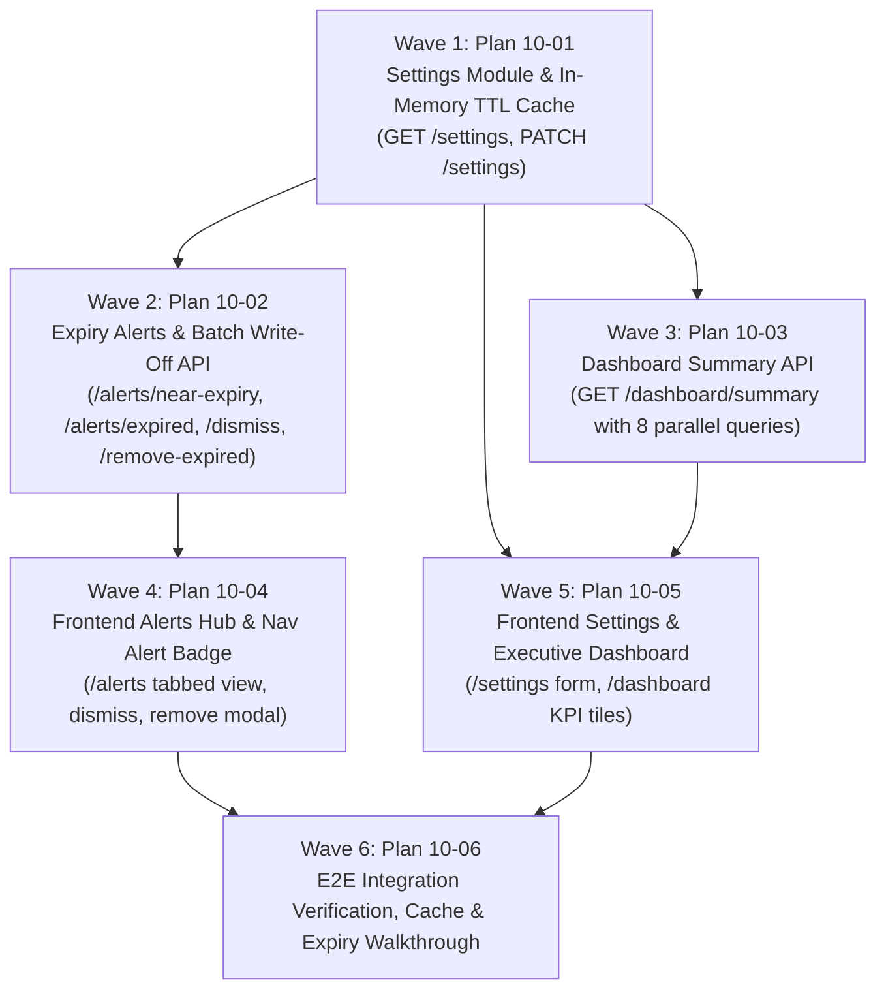

# Master Plan: Phase 10 — Expiry Alerts, Settings and Dashboard

**Phase:** Phase 10 — Expiry Alerts, Settings and Dashboard  
**Responsible Developer:** `dev3`  
**Status:** Planned & Ready for Execution  
**Primary Source:** [`tech.md`](file:///home/buddy/sandarp/kd-ioms/tech.md) Section 15, Section 2.1, Section 2.8, Section 9.2  
**Context:** [`.planning/phases/10-expiry-settings-dashboard/10-CONTEXT.md`](file:///home/buddy/sandarp/kd-ioms/.planning/phases/10-expiry-settings-dashboard/10-CONTEXT.md)  

---

## 1. Wave Execution Structure

The implementation of Phase 10 is decomposed into 6 sequential and parallel waves:

---

## 2. Plan Breakdown Matrix

| Plan ID | Plan Title | Wave | Developer | Key Deliverables | Link | Status |
| :---: | :--- | :---: | :---: | :--- | :--- | :---: |
| **`10-01`** | **Settings Module & In-Memory Cache** | 1 | `dev3` | `settings.validation.ts` (Zod schemas), `settings.service.ts` (60s TTL memory cache, DB fetch & update), `settings.controller.ts`, `settings.route.ts` (`GET /settings`, `PATCH /settings`), and integration tests. | [`10-01-PLAN.md`](file:///home/buddy/sandarp/kd-ioms/.planning/phases/10-expiry-settings-dashboard/10-01-PLAN.md) | ⏳ Ready |
| **`10-02`** | **Expiry Alerts & Batch Write-Off API** | 2 | `dev3` | Alert validation schemas, alert queries via `v_expiry_alerts` & `v_expired_stock`, `POST /alerts/near-expiry/:batchId/dismiss`, `POST /batches/:batchId/remove-expired` (`lockBatches`, past expiry check, `applyLedgerEntry(EXPIRY_WRITEOFF)`), and integration tests. | [`10-02-PLAN.md`](file:///home/buddy/sandarp/kd-ioms/.planning/phases/10-expiry-settings-dashboard/10-02-PLAN.md) | ⏳ Ready |
| **`10-03`** | **Dashboard Summary API** | 3 | `dev3` | `dashboard.service.ts` (`summary()` running 8 concurrent non-blocking count queries across pool connections), `dashboard.controller.ts`, `dashboard.route.ts` (`GET /dashboard/summary`), and integration tests. | [`10-03-PLAN.md`](file:///home/buddy/sandarp/kd-ioms/.planning/phases/10-expiry-settings-dashboard/10-03-PLAN.md) | ⏳ Ready |
| **`10-04`** | **Frontend Alerts Hub & Navigation Badge** | 4 | `dev3` | `frontend/src/features/alerts/` (api, hooks, types), `/alerts` tabbed page (Near Expiry, Expired Stock, Out of Stock), Keep/Dismiss action, Remove Expired Stock confirmation modal, and 60-second polling Nav alert badge. | [`10-04-PLAN.md`](file:///home/buddy/sandarp/kd-ioms/.planning/phases/10-expiry-settings-dashboard/10-04-PLAN.md) | ⏳ Ready |
| **`10-05`** | **Frontend Settings & Dashboard Hub** | 5 | `dev3` | `frontend/src/features/settings/` (api, hooks, forms), `/settings` page (threshold stepper, business profile editor with GSTIN validation), `frontend/src/features/dashboard/` (KPI tiles grid with deep-links and live stats). | [`10-05-PLAN.md`](file:///home/buddy/sandarp/kd-ioms/.planning/phases/10-expiry-settings-dashboard/10-05-PLAN.md) | ⏳ Ready |
| **`10-06`** | **E2E Integration Verification & Sign-Off** | 6 | `dev3` | Complete end-to-end integration walkthrough (setting threshold -> dynamic alert filtering -> dismiss batch -> fast-forward date / expire -> physical removal write-off -> dashboard reconciliation -> clean lint and build). | [`10-06-PLAN.md`](file:///home/buddy/sandarp/kd-ioms/.planning/phases/10-expiry-settings-dashboard/10-06-PLAN.md) | ⏳ Ready |

---

## 3. Phase Exit Criteria ("Done When")

- [ ] `GET /api/v1/settings` and `PATCH /api/v1/settings` allow viewing and modifying `expiryAlertDays` (1–730) and `businessProfile`.
- [ ] In-memory cache in `settings.service.ts` serves requests with 60-second TTL and evicts immediately on update.
- [ ] Updating `expiry_alert_days` immediately adjusts the output of `GET /api/v1/alerts/near-expiry`.
- [ ] Dismissing a near-expiry batch (`POST /api/v1/alerts/near-expiry/:batchId/dismiss`) removes it from the near-expiry view while still allowing it to appear in `GET /api/v1/alerts/expired` once its expiry date has passed.
- [ ] Attempting to dismiss an already-expired batch is rejected with 409 `INVALID_STATE_TRANSITION`.
- [ ] Physical write-off (`POST /api/v1/batches/:batchId/remove-expired`) requires `expiry_date < today_ist()`; unexpired batches are rejected with 409 `INVALID_STATE_TRANSITION`.
- [ ] Physical write-off calls `applyLedgerEntry(EXPIRY_WRITEOFF)` with negative full quantity, zeroing `batches.quantity_on_hand` and creating an immutable ledger entry.
- [ ] `GET /api/v1/dashboard/summary` executes 8 non-blocking parallel queries and returns figures that match 100% with underlying table totals.
- [ ] Frontend `/alerts` provides an intuitive tabbed interface for near-expiry, expired stock, and out-of-stock items with action buttons.
- [ ] Frontend `/settings` allows easy configuration of alert thresholds and invoice business details with validation.
- [ ] Frontend `/dashboard` renders live KPI tiles linking to relevant filtered operational queues.
- [ ] Navigation header includes a live alert badge refreshed every 60 seconds.
- [ ] Automated tests pass across backend and frontend (`npm test`).
- [ ] Clean build and zero lint errors (`npm run lint`, `npm run build`).
