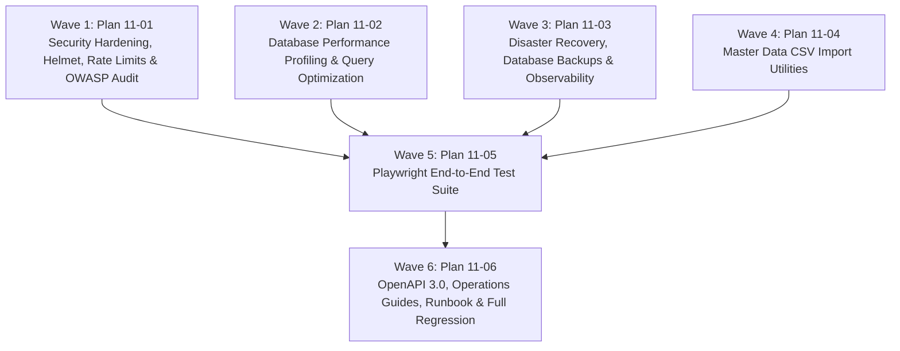

# Master Plan: Phase 11 — Hardening, Reliability and Go-Live

**Phase:** Phase 11 — Hardening, Reliability and Go-Live  
**Responsible Developer:** Shared Integration (Lead: `dev1`, Reviewers/Integration: `dev2`, `dev3`)  
**Status:** 📋 READY FOR EXECUTION  
**Primary Source:** [`tech.md`](file:///d:/coding/Projects/kd-ioms/tech.md) Section 16  
**Context:** [`.planning/phases/11-hardening-go-live/11-CONTEXT.md`](file:///d:/coding/Projects/kd-ioms/.planning/phases/11-hardening-go-live/11-CONTEXT.md)  

---

## 1. Wave Execution Structure

The implementation of Phase 11 is organized into 6 focused execution waves:

---

## 2. Plan Breakdown Matrix

| Plan ID | Plan Title | Wave | Developer | Key Deliverables | Link | Status |
| :---: | :--- | :---: | :---: | :--- | :--- | :---: |
| **`11-01`** | **Security Hardening & OWASP Top 10 Audit** | 1 | `dev1` | `helmet` integration, `searchScanLimiter` (60 req/min), scoped auth cookie flags, route authorization audit, and `docs/OWASP-TOP-10.md`. | [`11-01-PLAN.md`](file:///d:/coding/Projects/kd-ioms/.planning/phases/11-hardening-go-live/11-01-PLAN.md) | 📋 Ready |
| **`11-02`** | **Database Performance Profiling & Query Optimization** | 2 | `dev1` | Query profiling harness (`profile-queries.ts`), `EXPLAIN (ANALYZE, BUFFERS)` benchmarks, index scan validation, and `docs/PERFORMANCE-PROFILING.md`. | [`11-02-PLAN.md`](file:///d:/coding/Projects/kd-ioms/.planning/phases/11-hardening-go-live/11-02-PLAN.md) | 📋 Ready |
| **`11-03`** | **Disaster Recovery, Database Backups & Observability** | 3 | `dev1` | Standalone backup script (`backup-db.ts`), SHA-256 checksums, restore rehearsal runner, pool telemetry on `/api/v1/health`, keep-warm ping, and graceful shutdown. | [`11-03-PLAN.md`](file:///d:/coding/Projects/kd-ioms/.planning/phases/11-hardening-go-live/11-03-PLAN.md) | 📋 Ready |
| **`11-04`** | **Master Data CSV Import Utilities** | 4 | `dev1` | Two-stage CSV import scripts (`import-salts.ts`, `import-medicines.ts`) with mandatory `--dry-run`, data validation, and transaction rollback on error. | [`11-04-PLAN.md`](file:///d:/coding/Projects/kd-ioms/.planning/phases/11-hardening-go-live/11-04-PLAN.md) | 📋 Ready |
| **`11-05`** | **Playwright End-to-End Test Suite** | 5 | `dev1` | `playwright.config.ts`, full-lifecycle browser E2E test (`frontend/e2e/order-lifecycle.spec.ts`) covering retail onboarding through delivery refusal and invoicing. | [`11-05-PLAN.md`](file:///d:/coding/Projects/kd-ioms/.planning/phases/11-hardening-go-live/11-05-PLAN.md) | 📋 Ready |
| **`11-06`** | **OpenAPI 3.0, Operations Guides & Runbook** | 6 | `dev1` | Canonical OpenAPI 3.0 YAML spec (`docs/openapi.yaml`), Admin guide, Delivery guide, Go-Live runbook (`docs/RUNBOOK.md`), and full regression build verification. | [`11-06-PLAN.md`](file:///d:/coding/Projects/kd-ioms/.planning/phases/11-hardening-go-live/11-06-PLAN.md) | 📋 Ready |

---

## 3. Phase Exit Criteria ("Done When")

- [ ] Security headers (`helmet`) are active and reject insecure requests.
- [ ] Dedicated `searchScanLimiter` enforces 60 req/min on search and barcode resolution routes.
- [ ] Profiling proves catalog queries execute under 300ms and order approvals under 500ms p95.
- [ ] Database backup utility creates valid timestamped dumps with matching SHA-256 checksums.
- [ ] Restore rehearsal successfully reconstitutes clean database with all tables and records.
- [ ] Master data CSV import tools validate and import salts and medicines with `--dry-run` safety.
- [ ] Complete Playwright E2E browser test passes cleanly.
- [ ] Canonical OpenAPI 3.0 specification (`docs/openapi.yaml`), operations guides, and Go-Live runbook are authored in `docs/`.
- [ ] All linting (`npm run lint`), enum sync checks (`npm run sync-enums:check`), unit/integration tests (`npm run test`), and production builds (`npm run build`) pass cleanly with 0 errors.
