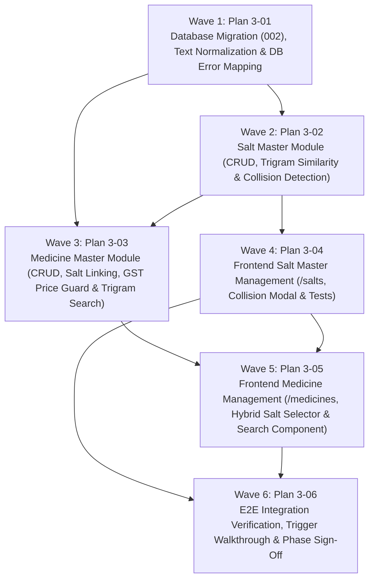

# Master Plan: Phase 3 — Medicines and Salts Master

**Phase:** Phase 3 — Medicines and Salts Master  
**Responsible Developer:** `dev2`  
**Status:** 📋 READY FOR EXECUTION  
**Primary Source:** [`tech.md`](file:///home/yash/D/kd-ioms/tech.md) Section 8  
**Context:** [`.planning/phases/3-medicines-salts/3-CONTEXT.md`](file:///home/yash/D/kd-ioms/.planning/phases/3-medicines-salts/3-CONTEXT.md)  

---

## 1. Wave Execution Structure

The implementation of Phase 3 is decomposed into 6 sequential and parallel waves:

---

## 2. Plan Breakdown Matrix

| Plan ID | Plan Title | Wave | Developer | Key Deliverables | Link | Status |
| :---: | :--- | :---: | :---: | :--- | :--- | :---: |
| **`3-01`** | **Database Migration (002), Normalization & Error Mapping** | 1 | `dev2` | Migration `002_salt_rename_trigger.sql` (automated `salts_text` sync on salt rename, case-insensitive identity unique index on `medicines`), `normalize.ts` utility, and updated `db-error-map.ts`. | [`3-01-PLAN.md`](file:///home/yash/D/kd-ioms/.planning/phases/3-medicines-salts/3-01-PLAN.md) | 📋 Ready |
| **`3-02`** | **Salt Master Module (CRUD, Trigram Similarity & Collision Guard)** | 2 | `dev2` | Validation schema, `salt.service.ts` (`listSalts`, `suggestSalts`, `createSalt` with `pg_trgm` > 0.5 similarity check, `updateSalt` with `SALT_IN_USE` check), `salt.controller.ts`, `salt.route.ts`, and integration tests. | [`3-02-PLAN.md`](file:///home/yash/D/kd-ioms/.planning/phases/3-medicines-salts/3-02-PLAN.md) | 📋 Ready |
| **`3-03`** | **Medicine Master Module (CRUD, GST Price Guard & Trigram Search)** | 3 | `dev2` | Validation schema, `medicine.service.ts` (`createMedicine`, `listMedicines`, `getMedicineById` with stock aggregates, `updateMedicine` with GST price ceiling guard, `searchMedicines` via `pg_trgm`), routes, and integration tests. | [`3-03-PLAN.md`](file:///home/yash/D/kd-ioms/.planning/phases/3-medicines-salts/3-03-PLAN.md) | 📋 Ready |
| **`3-04`** | **Frontend Salt Master Management (`/salts`, Modals & Collision Alerts)** | 4 | `dev2` | Feature module `salts` (api, hooks, schemas), Admin `/salts` page, `SaltTable`, `AddSaltModal` with live typeahead near-match warning and confirm checkbox, `EditSaltModal`, and component tests. | [`3-04-PLAN.md`](file:///home/yash/D/kd-ioms/.planning/phases/3-medicines-salts/3-04-PLAN.md) | 📋 Ready |
| **`3-05`** | **Frontend Medicine Management & Reusable Search Component** | 5 | `dev2` | Feature module `medicines`, Admin `/medicines` directory, `/medicines/new` and edit screens, quick GST slab presets, hybrid salt chip selector with inline "+ Add New Salt" modal, reusable `MedicineSearch` component, and tests. | [`3-05-PLAN.md`](file:///home/yash/D/kd-ioms/.planning/phases/3-medicines-salts/3-05-PLAN.md) | 📋 Ready |
| **`3-06`** | **E2E Integration Verification, Trigger Walkthrough & Phase Sign-Off** | 6 | `dev2` | End-to-end lifecycle verification (salt creation -> duplicate detection -> collision warning -> medicine linking -> trigger update on salt rename -> in-use guard -> GST price ceiling guard -> trigram search), test suites, lint, and build clean. | [`3-06-PLAN.md`](file:///home/yash/D/kd-ioms/.planning/phases/3-medicines-salts/3-06-PLAN.md) | 📋 Ready |

---

## 3. Phase Exit Criteria ("Done When")

- [ ] Database migration `002_salt_rename_trigger.sql` applied cleanly with verified Postgres trigger and case-insensitive index.
- [ ] Salt exact duplicates (case-insensitive) rejected with 409 `DUPLICATE_RESOURCE`.
- [ ] Salt near-matches (similarity > 0.5) rejected with 409 `SALT_SIMILAR_EXISTS` unless confirmed with `{ confirmSimilar: true }`.
- [ ] Salt deactivation blocked with 409 `SALT_IN_USE` when linked to active medicines.
- [ ] Renaming a salt updates `salts_text` across all linked medicines automatically via the database trigger.
- [ ] Medicine creation validates 0–10 active salt IDs; rejects non-existent/inactive IDs with 400 `VALIDATION_ERROR` targeting `saltIds.<index>`.
- [ ] Medicine deduplication blocks duplicates on `(name, company, packSize)` across differing casing with 409 `DUPLICATE_RESOURCE`.
- [ ] Modifying medicine `gstRate` blocked with 422 `PRICE_EXCEEDS_MRP` if any existing batch selling price with the new GST exceeds its MRP.
- [ ] Trigram search endpoint `GET /medicines/search` returns matching medicines by name and salts text for Admin and Delivery roles.
- [ ] Admin UI allows creating, editing, and listing salts and medicines, featuring hybrid salt chip selection with inline salt creation.
- [ ] Reusable `MedicineSearch` component verified and ready for downstream phases.
- [ ] Automated tests pass across backend and frontend (`npm test` clean).
- [ ] Workspace compiles and passes linting (`npm run lint`, `npm run build` clean).
