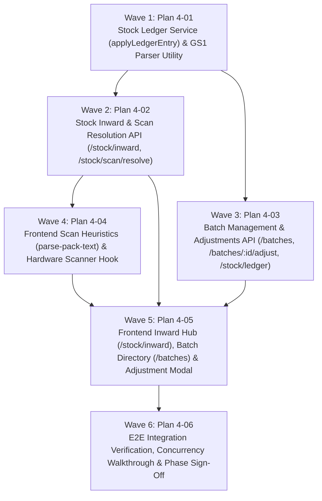

# Master Plan: Phase 4 — Stock Inward, Batches and Append-Only Ledger

**Phase:** Phase 4 — Stock Inward, Batches and Append-Only Ledger  
**Responsible Developer:** `dev1`  
**Status:** Planned & Ready for Execution  
**Primary Source:** [`tech.md`](file:///d:/coding/Projects/kd-ioms/tech.md) Section 9, Section 2.8, Section 2.9  
**Context:** [`.planning/phases/4-stock-inward-batches/4-CONTEXT.md`](file:///d:/coding/Projects/kd-ioms/.planning/phases/4-stock-inward-batches/4-CONTEXT.md)  

---

## 1. Wave Execution Structure

The implementation of Phase 4 is decomposed into 6 sequential and parallel waves:

---

## 2. Plan Breakdown Matrix

| Plan ID | Plan Title | Wave | Developer | Key Deliverables | Link | Status |
| :---: | :--- | :---: | :---: | :--- | :--- | :---: |
| **`4-01`** | **Stock Ledger Service & GS1 Utilities** | 1 | `dev1` | `applyLedgerEntry()` in `stock-ledger.service.ts` (row locking, delta sign rules, non-negative balance check, `INSUFFICIENT_STOCK` 422), `utils/gtin.ts` (GS1 Application Identifier AI-01, AI-10, AI-17 parser), and unit tests. | [`4-01-PLAN.md`](file:///d:/coding/Projects/kd-ioms/.planning/phases/4-stock-inward-batches/4-01-PLAN.md) | ⏳ Ready |
| **`4-02`** | **Stock Inward & Scan Resolution API** | 2 | `dev1` | Validation schemas, `stock-inward.service.ts` (`inwardStock` with batch identity top-up vs create, `lockMedicines`, GST price ceiling check, past expiry check, GTIN mismatch check), routes `POST /stock/inward`, `POST /stock/scan/resolve`, and integration tests. | [`4-02-PLAN.md`](file:///d:/coding/Projects/kd-ioms/.planning/phases/4-stock-inward-batches/4-02-PLAN.md) | ⏳ Ready |
| **`4-03`** | **Batch Management & Adjustments API** | 3 | `dev1` | Validation schemas, `batch.service.ts` (`listBatches` with 90d near-expiry/expired filters, `getBatchById`, `updateBatch`, `adjustBatch` with `EXPIRY_WRITEOFF` past-date check and 5–300 char reason, `listLedger`), routes `/batches` and `/stock/ledger`, and integration tests. | [`4-03-PLAN.md`](file:///d:/coding/Projects/kd-ioms/.planning/phases/4-stock-inward-batches/4-03-PLAN.md) | ⏳ Ready |
| **`4-04`** | **Frontend Scan Heuristics & Hardware Scanner Hook** | 4 | `dev1` | `parse-pack-text.ts` (packaging OCR text regex heuristics for Batch, Expiry, MRP candidates), `useBarcodeScanner` hook (USB/Bluetooth hardware scanner keystroke detection), `CameraScannerModal` (HTML5 camera video stream + file drop), and unit tests. | [`4-04-PLAN.md`](file:///d:/coding/Projects/kd-ioms/.planning/phases/4-stock-inward-batches/4-04-PLAN.md) | ⏳ Ready |
| **`4-05`** | **Frontend Stock Inward, Batch Directory & Adjustment UI** | 5 | `dev1` | Features (`stock`, `batches`), `/stock/inward` (3-way capture mode, `ScanConfirmForm` with live price incl. GST and MRP ceiling check), `/batches` directory (filters, status toggle), `/batches/:batchId` audit view, `BatchAdjustModal`, `/stock/ledger`, and tests. | [`4-05-PLAN.md`](file:///d:/coding/Projects/kd-ioms/.planning/phases/4-stock-inward-batches/4-05-PLAN.md) | ⏳ Ready |
| **`4-06`** | **E2E Integration Verification & Phase Sign-Off** | 6 | `dev1` | Multi-step lifecycle walkthrough (inward receipt -> batch top-up -> ledger balance reconciliation -> adjustment -> expiry write-off guard -> price ceiling guard), full test suite execution, zero lint errors, clean build, and Phase 4 completion sign-off. | [`4-06-PLAN.md`](file:///d:/coding/Projects/kd-ioms/.planning/phases/4-stock-inward-batches/4-06-PLAN.md) | ⏳ Ready |

---

## 3. Phase Exit Criteria ("Done When")

- [ ] `applyLedgerEntry()` is the single source of truth for changing `batches.quantity_on_hand`; direct SQL updates outside this service are banned.
- [ ] Concurrent parallel inward calls for the identical batch aggregate quantities correctly; no duplicate batch rows created and final balance equals the sum.
- [ ] Inward receipt with expiry date in the past rejected with 422 `EXPIRY_IN_PAST`.
- [ ] Inward receipt where selling price incl. GST exceeds MRP rejected with 422 `PRICE_EXCEEDS_MRP`.
- [ ] Inward receipt with a GTIN already registered to a different medicine rejected with 422 `BATCH_MEDICINE_MISMATCH`.
- [ ] Batch list (`GET /api/v1/batches`) accurately filters by status, near-expiry (<= 90 days), and expired state.
- [ ] Stock adjustments (`DAMAGE`, `CORRECTION`, `EXPIRY_WRITEOFF`) require a 5–300 character reason and update batch balance and ledger rows atomically.
- [ ] Attempting an `EXPIRY_WRITEOFF` adjustment on an unexpired batch is rejected with 409 `INVALID_STATE_TRANSITION`.
- [ ] GS1 parser handles GTIN-14, variable-length batch number, and YYMMDD expiry format.
- [ ] Frontend `/stock/inward` allows receiving stock via hybrid hardware scanner, camera scan, or manual entry with prefilled confirmation form.
- [ ] Frontend `/batches` provides search, status toggles, and adjustment dialog.
- [ ] Automated tests pass across backend and frontend (`npm test`).
- [ ] Workspace compiles and passes linting (`npm run lint`, `npm run build` with 0 errors).
