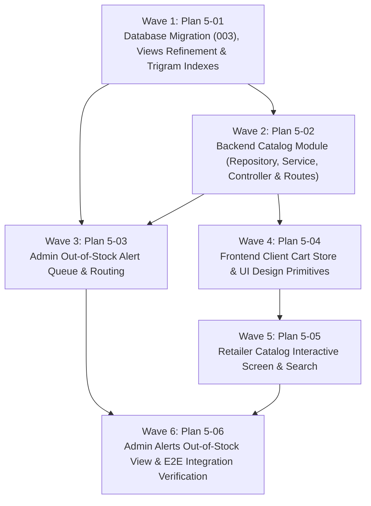

# Master Plan: Phase 5 — Catalog and Availability

**Phase:** Phase 5 — Catalog and Availability  
**Responsible Developer:** `dev2`  
**Status:** ✅ COMPLETED & VERIFIED  
**Primary Source:** [`tech.md`](file:///home/yash/D/kd-ioms/tech.md) Section 10  
**Context:** [`.planning/phases/5-catalog-availability/5-CONTEXT.md`](file:///home/yash/D/kd-ioms/.planning/phases/5-catalog-availability/5-CONTEXT.md)  

---

## 1. Wave Execution Structure

The implementation of Phase 5 is decomposed into 6 sequential and parallel waves:

---

## 2. Plan Breakdown Matrix

| Plan ID | Plan Title | Wave | Developer | Key Deliverables | Link | Status |
| :---: | :--- | :---: | :---: | :--- | :--- | :---: |
| **`5-01`** | **Database Migration (003), Views Refinement & Trigram Indexes** | 1 | `dev2` | Migration `003_catalog_views.sql` updating `v_medicine_availability` and `v_catalog` with `salts_text`, `salt_ids`, dynamic availability math, price ceilings, compound index on `batches`, GIN trigram indexes on `medicines`, and SQL view verification tests. | [`5-01-PLAN.md`](file:///home/yash/D/kd-ioms/.planning/phases/5-catalog-availability/5-01-PLAN.md) | ✅ Passed |
| **`5-02`** | **Backend Catalog Module (Repository, Service, Controller & Routes)** | 2 | `dev2` | Zod validation schemas, `catalog.service.ts` (`getCatalog`, `getCatalogItem` with salt hydration and information masking), `catalog.controller.ts`, `catalog.route.ts` with `requireApprovedRetailer`, router mount, and integration tests. | [`5-02-PLAN.md`](file:///home/yash/D/kd-ioms/.planning/phases/5-catalog-availability/5-02-PLAN.md) | ✅ Passed |
| **`5-03`** | **Admin Out-of-Stock Alert Queue & Routing** | 3 | `dev2` | Service method `getOutOfStockAlerts`, `alerts.route.ts` mounting `GET /alerts/out-of-stock` restricted to `ADMIN`, router registration, and role/filter integration tests. | [`5-03-PLAN.md`](file:///home/yash/D/kd-ioms/.planning/phases/5-catalog-availability/5-03-PLAN.md) | ✅ Passed |
| **`5-04`** | **Frontend Client Cart Store & UI Design Primitives** | 4 | `dev2` | `PriceTag.tsx` with struck-through MRP and savings badge, user-scoped `useCart` store backed by `localStorage` (`kd_cart_${userId}`), `FloatingCartBar.tsx` sticky bottom bar, and component/store unit tests. | [`5-04-PLAN.md`](file:///home/yash/D/kd-ioms/.planning/phases/5-catalog-availability/5-04-PLAN.md) | ✅ Passed |
| **`5-05`** | **Retailer Catalog Interactive Screen & Search** | 5 | `dev2` | API client `catalog.api.ts`, debounced search hook `useCatalog`, `CatalogSearchHeader`, `MedicineCatalogCard` with live quantity stepper clamped to `availableQty`, responsive grid, replacement of placeholder `/catalog/page.tsx`, and component tests. | [`5-05-PLAN.md`](file:///home/yash/D/kd-ioms/.planning/phases/5-catalog-availability/5-05-PLAN.md) | ✅ Passed |
| **`5-06`** | **Admin Alerts Out-of-Stock View & E2E Integration Verification** | 6 | `dev2` | Admin alerts interface `/admin/alerts` Out-of-Stock tab with direct inward restock navigation, end-to-end multi-batch lifecycle verification test suite (mixed fresh, near-expiry, expired, blocked, reserved), workspace lint and build pass. | [`5-06-PLAN.md`](file:///home/yash/D/kd-ioms/.planning/phases/5-catalog-availability/5-06-PLAN.md) | ✅ Passed |

---

## 3. Phase Exit Criteria ("Done When")

- [x] Database migration `003_catalog_views.sql` applied cleanly with verified views and indexes.
- [x] Multiple active batches at different selling prices correctly expose the highest selling price incl. GST.
- [x] Expired batches (`expiry_date < today_ist()`) and blocked batches (`status = 'BLOCKED'`) are excluded from availability math.
- [x] Available quantity decrements when orders are in `PLACED` status and restores immediately if cancelled.
- [x] Over-reservation clamps available quantity to 0 (never negative) and marks `inStock = false`.
- [x] When no sellable stock exists, `maxMrp` and `maxPriceInclGst` evaluate to `null`.
- [x] Retailers in `PENDING` or `REJECTED` status receive 403 `RETAILER_NOT_APPROVED` when accessing `/catalog`.
- [x] Approved retailers, Delivery partners, and Admins can query `/catalog` with hybrid debounced search (300ms) and filters.
- [x] Retailer responses strictly mask batch numbers, purchase rates, supplier details, and expiry dates.
- [x] Admin alert queue `GET /alerts/out-of-stock` delivers zero-stock active medicines to `/admin/alerts`.
- [x] Retailer catalog UI features responsive medicine cards, quantity steppers bounded by `availableQty`, and a sticky floating cart summary.
- [x] Automated tests pass across backend and frontend (`npm test` clean - 217/217 passed).
- [x] Workspace compiles and passes linting (`npm run lint`, `npm run build` clean).
