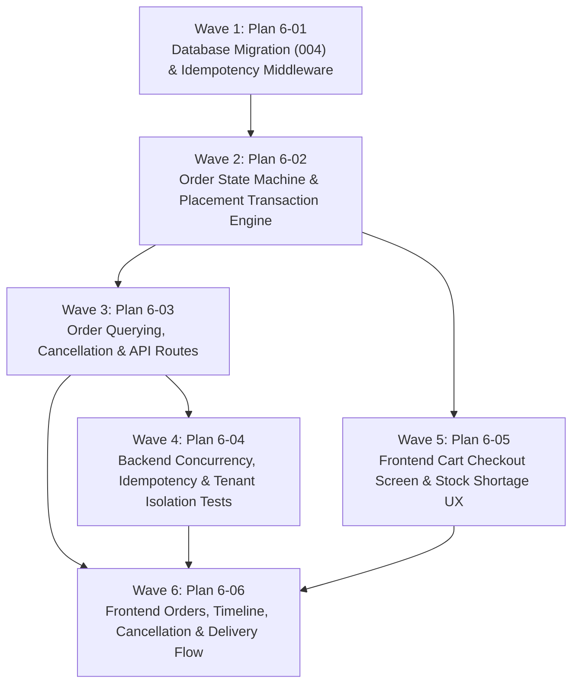

# Master Plan: Phase 6 — Order Placement and Cancellation

**Phase:** Phase 6 — Order Placement and Cancellation  
**Responsible Developer:** `dev2`  
**Status:** 🟡 PLANNED (Ready for `/gsd-execute-phase 6`)  
**Primary Source:** [`tech.md`](file:///home/yash/D/kd-ioms/tech.md) Section 11  
**Context:** [`.planning/phases/6-order-placement-cancel/6-CONTEXT.md`](file:///home/yash/D/kd-ioms/.planning/phases/6-order-placement-cancel/6-CONTEXT.md)  

---

## 1. Wave Execution Structure

The implementation of Phase 6 is decomposed into 6 sequential and parallel waves:

---

## 2. Plan Breakdown Matrix

| Plan ID | Plan Title | Wave | Developer | Key Deliverables | Link | Status |
| :---: | :--- | :---: | :---: | :--- | :--- | :---: |
| **`6-01`** | **Database Migration (004) & Idempotency Middleware** | 1 | `dev2` | Migration `004_idempotency_keys.sql`, `idempotency.ts` Express middleware (UUID validation, SHA-256 canonical hashing, 200 replay with `X-Idempotent-Replay: true`, 409 `IDEMPOTENCY_KEY_REUSED` on mismatch), and unit test suite. | [`6-01-PLAN.md`](file:///home/yash/D/kd-ioms/.planning/phases/6-order-placement-cancel/6-01-PLAN.md) | 🟡 Planned |
| **`6-02`** | **Order State Machine & Placement Transaction Engine** | 2 | `dev2` | `order.helpers.ts` (`assertTransition`), Zod validation schemas (`placeOrderSchema`), and atomic `orderService.placeOrder` (`lockMedicines` in ascending order, live availability check, 409 `INSUFFICIENT_STOCK` with itemized shortage details, 409 `PRICE_CHANGED` quote validation, `next_document_number('ORD')`, multi-row insertion, and atomic idempotency persistence). | [`6-02-PLAN.md`](file:///home/yash/D/kd-ioms/.planning/phases/6-order-placement-cancel/6-02-PLAN.md) | 🟡 Planned |
| **`6-03`** | **Order Querying, Cancellation & API Routes** | 3 | `dev2` | Service methods `getOrders`, `getOrderById` (with tenant isolation and role allocation masking), `cancelOrder` (cancellation while `PLACED`, instant availability restore), `order.controller.ts`, `order.route.ts`, and mounting in `routes/index.ts` at `/api/v1/orders`. | [`6-03-PLAN.md`](file:///home/yash/D/kd-ioms/.planning/phases/6-order-placement-cancel/6-03-PLAN.md) | 🟡 Planned |
| **`6-04`** | **Backend Concurrency, Idempotency & Tenant Isolation Tests** | 4 | `dev2` | Rigorous integration test suite verifying simultaneous concurrency race conditions (1 winner, 1 receiving 409 `INSUFFICIENT_STOCK`), idempotency determinism, payload tampering rejection, stale price quote checks, cancellation state invariants, and tenant isolation (404 on cross-retailer access). | [`6-04-PLAN.md`](file:///home/yash/D/kd-ioms/.planning/phases/6-order-placement-cancel/6-04-PLAN.md) | 🟡 Planned |
| **`6-05`** | **Frontend Cart Checkout Screen & Stock Shortage UX** | 5 | `dev2` | Cart checkout screen at `/cart` integrated with `useCart`, line items review, delivery note (max 300 chars), per-attempt idempotency key management, 409 `INSUFFICIENT_STOCK` resolution with one-tap "Use Available" button, price change alerts, cart clearing, and redirect. | [`6-05-PLAN.md`](file:///home/yash/D/kd-ioms/.planning/phases/6-order-placement-cancel/6-05-PLAN.md) | 🟡 Planned |
| **`6-06`** | **Frontend Orders, Timeline, Cancellation & Delivery Flow** | 6 | `dev2` | `OrderTimeline.tsx` milestone visualization, `/orders` filterable list, `/orders/:orderId` detail view with Cancel Order confirmation modal, `/delivery/orders/new` on-behalf pharmacy order placement flow, and full test/lint/build workspace validation. | [`6-06-PLAN.md`](file:///home/yash/D/kd-ioms/.planning/phases/6-order-placement-cancel/6-06-PLAN.md) | 🟡 Planned |

---

## 3. Phase Exit Criteria ("Done When")

- [ ] Database migration `004_idempotency_keys.sql` applied cleanly with verified primary key `(key, user_id)` and indexes.
- [ ] Concurrency test proves two simultaneous orders competing for remaining inventory results in exactly one success; the other receives 409 `INSUFFICIENT_STOCK`.
- [ ] Replay of same `Idempotency-Key` and body returns cached 200 response without creating duplicate order or incrementing document sequences.
- [ ] Replay of same `Idempotency-Key` with modified body returns 409 `IDEMPOTENCY_KEY_REUSED`.
- [ ] Order with price quote below current catalog price returns 409 `PRICE_CHANGED`.
- [ ] Retailer cannot cancel order once moved out of `PLACED` status (returns 409 `INVALID_STATE_TRANSITION`).
- [ ] Retailer cannot view orders belonging to other pharmacies (returns 404 `NOT_FOUND`).
- [ ] Cart checkout `/cart` highlights short lines with available quantity and one-tap "Use available" action.
- [ ] Orders list and detail render with status timeline (`OrderTimeline`) and Cancel button visible only while `PLACED`.
- [ ] Delivery partners can place orders on behalf of approved pharmacies via `/delivery/orders/new`.
- [ ] All automated tests pass across backend and frontend (`npm test` clean).
- [ ] Workspace compiles and passes linting (`npm run lint`, `npm run build` clean).
