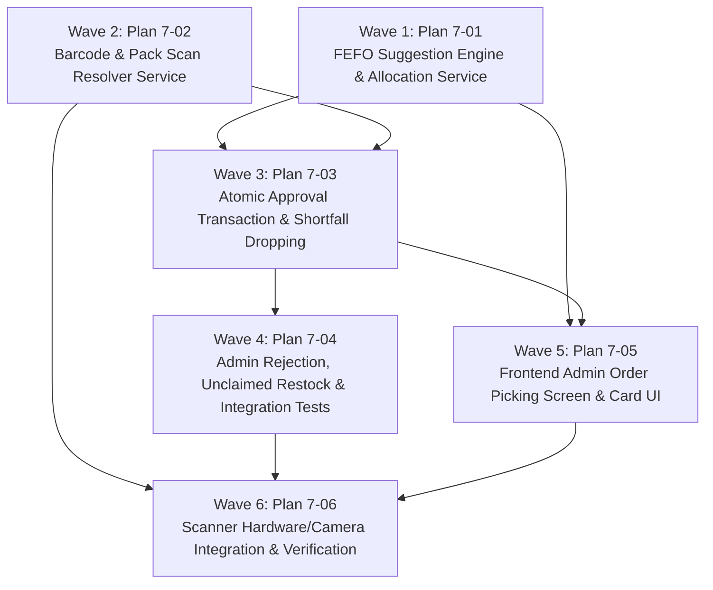

# Master Plan: Phase 7 — Order Approval and Batch Picking

**Phase:** Phase 7 — Order Approval and Batch Picking  
**Responsible Developer:** `dev1`  
**Status:** 📋 READY FOR EXECUTION  
**Primary Source:** [`tech.md`](file:///d:/coding/Projects/kd-ioms/tech.md) Section 12  
**Context:** [`.planning/phases/7-approval-picking/7-CONTEXT.md`](file:///d:/coding/Projects/kd-ioms/.planning/phases/7-approval-picking/7-CONTEXT.md)  

---

## 1. Wave Execution Structure

The implementation of Phase 7 is decomposed into 6 sequential and parallel waves:

---

## 2. Plan Breakdown Matrix

| Plan ID | Plan Title | Wave | Developer | Key Deliverables | Link | Status |
| :---: | :--- | :---: | :---: | :--- | :--- | :---: |
| **`7-01`** | **FEFO Suggestion Engine & Allocation Service** | 1 | `dev1` | `allocation.service.ts` (`suggest`), `GET /orders/:orderId/pick-suggestions` endpoint, price cap check (`effectivePrice <= quotedPrice`), greedy FEFO suggestion calculation, and unit tests. | [`7-01-PLAN.md`](file:///d:/coding/Projects/kd-ioms/.planning/phases/7-approval-picking/7-01-PLAN.md) | 📋 Ready |
| **`7-02`** | **Barcode & Pack Scan Resolver Service** | 2 | `dev1` | `allocationService.resolveScan`, GS1-128/DataMatrix/GTIN parsing, composite `(batch_number, expiry_date)` matching, `POST /batches/resolve-scan` endpoint, and unit tests. | [`7-02-PLAN.md`](file:///d:/coding/Projects/kd-ioms/.planning/phases/7-approval-picking/7-02-PLAN.md) | 📋 Ready |
| **`7-03`** | **Atomic Approval Transaction & Shortfall Dropping** | 3 | `dev1` | `orderService.approveOrder`, ascending batch locking (`lockBatches`), validation guards (`PICK_EXCEEDS_REQUESTED`, `PICK_EXCEEDS_ON_HAND`, `BATCH_EXPIRED`, `PRICE_EXCEEDS_QUOTE`), `order_allocations` inserts, `applyLedgerEntry(OUTWARD)` reduction, shortfall drop, and `POST /orders/:orderId/approve` route. | [`7-03-PLAN.md`](file:///d:/coding/Projects/kd-ioms/.planning/phases/7-approval-picking/7-03-PLAN.md) | 📋 Ready |
| **`7-04`** | **Admin Rejection, Unclaimed Restock & Integration Tests** | 4 | `dev1` | `orderService.rejectOrder`, `POST /orders/:orderId/reject` route, automatic `applyLedgerEntry(RESTOCK)` on unclaimed approved orders, state machine invariants, and comprehensive integration test suite. | [`7-04-PLAN.md`](file:///d:/coding/Projects/kd-ioms/.planning/phases/7-approval-picking/7-04-PLAN.md) | 📋 Ready |
| **`7-05`** | **Frontend Admin Order Picking Screen & Card UI** | 5 | `dev1` | React components (`OrderItemPickCard`, `FefoSuggestionChips`, `BatchAllocationRow`, `OrderRejectModal`), picking hook (`useOrderPicking`), `/orders/[orderId]/pick` page, and component unit tests. | [`7-05-PLAN.md`](file:///d:/coding/Projects/kd-ioms/.planning/phases/7-approval-picking/7-05-PLAN.md) | 📋 Ready |
| **`7-06`** | **Scanner Hardware/Camera Integration & Verification** | 6 | `dev1` | Barcode gun keyboard listener (`useBarcodeScanner`), camera viewfinder (`CameraScannerModal`), audio-visual chime/flash on pick, full regression test run (`npm test`), lint, and production build. | [`7-06-PLAN.md`](file:///d:/coding/Projects/kd-ioms/.planning/phases/7-approval-picking/7-06-PLAN.md) | 📋 Ready |

---

## 3. Phase Exit Criteria ("Done When")

- [ ] `GET /api/v1/orders/:orderId/pick-suggestions` returns active unexpired batches in strict FEFO order with `withinQuote` flags and calculated `suggestedQty`.
- [ ] `POST /api/v1/batches/resolve-scan` accurately matches barcodes and pack strings to active warehouse batches or returns 404 `BATCH_NOT_FOUND`.
- [ ] `POST /api/v1/orders/:orderId/approve` locks batches in ascending numeric order, records `order_allocations`, triggers `OUTWARD` ledger rows, drops shortfall quantities, and transitions order to `APPROVED`.
- [ ] Any invalid pick (expired batch, price exceeding quoted ceiling, mismatched medicine, quantity > on hand) rejects with appropriate 422 error and aborts transaction cleanly.
- [ ] `POST /api/v1/orders/:orderId/reject` on an unclaimed `APPROVED` order executes `RESTOCK` (+delta) ledger rows for every allocated batch, restoring exact inventory.
- [ ] Admin picking UI provides expandable item cards, FEFO suggestion chips, and instant scan-to-pick incrementing.
- [ ] All automated tests pass across backend and frontend (`npm test` clean).
- [ ] TypeScript and Next.js production builds finish with 0 errors (`npm run build`).
