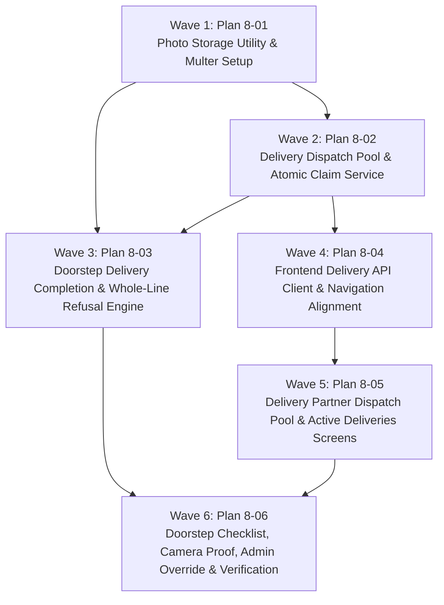

# Master Plan: Phase 8 — Delivery, Refusal and Proof

**Phase:** Phase 8 — Delivery, Refusal and Proof  
**Responsible Developer:** `dev2`  
**Status:** 📋 READY FOR EXECUTION  
**Primary Source:** [`tech.md`](file:///d:/coding/Projects/kd-ioms/tech.md) Section 13  
**Context:** [`.planning/phases/8-delivery-refusal/8-CONTEXT.md`](file:///d:/coding/Projects/kd-ioms/.planning/phases/8-delivery-refusal/8-CONTEXT.md)  

---

## 1. Wave Execution Structure

The implementation of Phase 8 is decomposed into 6 sequential and parallel waves:

---

## 2. Plan Breakdown Matrix

| Plan ID | Plan Title | Wave | Developer | Key Deliverables | Link | Status |
| :---: | :--- | :---: | :---: | :--- | :--- | :---: |
| **`8-01`** | **Photo Storage Utility & Multer Setup** | 1 | `dev2` | Install `multer` & `@types/multer`, update `backend/src/config/env.ts`, create `backend/src/utils/storage.ts` (Supabase Storage with local filesystem fallback), update state machine `ALLOWED_TRANSITIONS` for `OUT_FOR_DELIVERY -> APPROVED`, and unit tests. | [`8-01-PLAN.md`](file:///d:/coding/Projects/kd-ioms/.planning/phases/8-delivery-refusal/8-01-PLAN.md) | 📋 Ready |
| **`8-02`** | **Delivery Dispatch Pool & Atomic Claim Service** | 2 | `dev2` | `delivery.types.ts`, `delivery.validation.ts`, `delivery.service.ts` (`getPoolOrders`, `claimOrder`, `releaseOrder`, `overrideOrder`, `getPartnerOrders`, `getOrderDetail`), `delivery.controller.ts`, `delivery.route.ts`, router registration, and atomic claim concurrency race tests. | [`8-02-PLAN.md`](file:///d:/coding/Projects/kd-ioms/.planning/phases/8-delivery-refusal/8-02-PLAN.md) | 📋 Ready |
| **`8-03`** | **Doorstep Delivery Completion & Whole-Line Refusal Engine** | 3 | `dev2` | Multer memory storage middleware (5MB limit, JPEG/PNG/WebP), `deliveryService.completeDelivery`, pre-transaction photo upload, whole-line refusal with `RETURN_IN` ledger restock per allocation, final status (`DELIVERED` vs `REJECTED`), and integration tests. | [`8-03-PLAN.md`](file:///d:/coding/Projects/kd-ioms/.planning/phases/8-delivery-refusal/8-03-PLAN.md) | 📋 Ready |
| **`8-04`** | **Frontend Delivery API Client & Navigation Alignment** | 4 | `dev2` | `frontend/src/lib/api/delivery.api.ts`, React Query hooks (`useDeliveryPool`, `useClaimOrder`, `usePartnerOrders`, `useDeliveryDetail`, `useCompleteDelivery`, `useReleaseOrder`), update `(delivery)/layout.tsx` `BottomNav` to `/delivery/pool`, `/delivery/orders`, `/delivery/orders/new`. | [`8-04-PLAN.md`](file:///d:/coding/Projects/kd-ioms/.planning/phases/8-delivery-refusal/8-04-PLAN.md) | 📋 Ready |
| **`8-05`** | **Delivery Partner Dispatch Pool & Active Deliveries Screens** | 5 | `dev2` | Dispatch Pool card feed at `/delivery/pool` (with claim action, race-condition toast, pull-to-refresh) and My Deliveries screen at `/delivery/orders` (Active vs Completed tabs, stop cards), with component tests. | [`8-05-PLAN.md`](file:///d:/coding/Projects/kd-ioms/.planning/phases/8-delivery-refusal/8-05-PLAN.md) | 📋 Ready |
| **`8-06`** | **Doorstep Checklist, Camera Proof, Admin Override & Verification** | 6 | `dev2` | Doorstep delivery checklist at `/delivery/orders/[orderId]` (pharmacy contact card, directions link, tap-to-call, whole-line Accept/Refuse toggles, camera proof capture, sticky submit footer), Admin order view integration, regression test suite, and production build verification. | [`8-06-PLAN.md`](file:///d:/coding/Projects/kd-ioms/.planning/phases/8-delivery-refusal/8-06-PLAN.md) | 📋 Ready |

---

## 3. Phase Exit Criteria ("Done When")

- [ ] `GET /api/v1/delivery/pool` returns approved unassigned wholesale orders sorted oldest first.
- [ ] `POST /api/v1/delivery/orders/:orderId/claim` executes atomic update; 10 simultaneous claims result in exactly 1 winner and 9 receiving 409 `ORDER_ALREADY_CLAIMED`.
- [ ] Assigned partner can self-release order back to pool via `POST /api/v1/delivery/orders/:orderId/release`, and Admin can override/reassign via `POST /api/v1/delivery/orders/:orderId/override`.
- [ ] `POST /api/v1/delivery/orders/:orderId/complete` handles multipart upload with photo and line decisions.
- [ ] Refusing an item restores allocated batch quantities via `RETURN_IN` (+delta) ledger rows with complete audit records.
- [ ] 100% item refusal transitions order to `REJECTED` and generates no invoice.
- [ ] At least one accepted item transitions order to `DELIVERED` with `delivered_at` timestamp.
- [ ] Photo upload failure aborts with 502 `EXTERNAL_SERVICE_ERROR`, leaving database and stock completely unchanged.
- [ ] Delivery partner interface works seamlessly on mobile viewports with large touch targets (>= 44px) and native camera capture.
- [ ] Admin can view assigned delivery partner, delivery photo proof, line refusal reasons, and trigger pool override in `/orders/[orderId]`.
- [ ] All automated tests pass across backend and frontend (`npm test` clean).
- [ ] TypeScript and Next.js production builds finish with 0 errors (`npm run build`).
