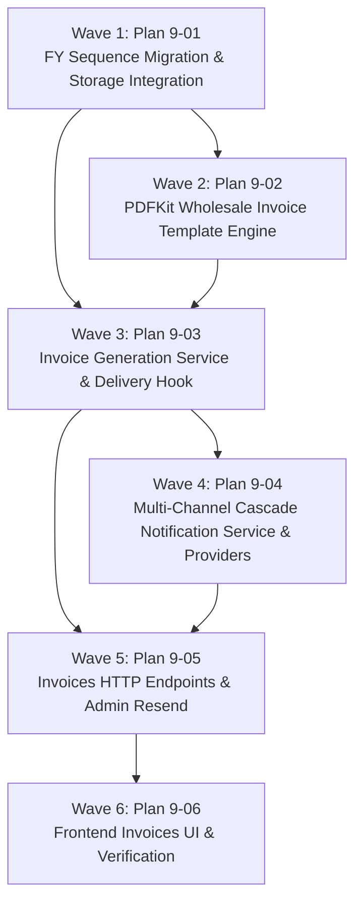

# Master Plan: Phase 9 — Invoicing and Multi-Channel Notifications

**Phase:** Phase 9 — Invoicing and Multi-Channel Notifications  
**Responsible Developer:** `dev3`  
**Status:** 📋 READY FOR EXECUTION  
**Primary Source:** [`tech.md`](file:///home/buddy/sandarp/kd-ioms/tech.md) Section 14  
**Context:** [`.planning/phases/9-invoice-notifications/9-CONTEXT.md`](file:///home/buddy/sandarp/kd-ioms/.planning/phases/9-invoice-notifications/9-CONTEXT.md)  

---

## 1. Wave Execution Structure

The implementation of Phase 9 is decomposed into 6 sequential and parallel waves:

---

## 2. Plan Breakdown Matrix

| Plan ID | Plan Title | Wave | Developer | Key Deliverables | Link | Status |
| :---: | :--- | :---: | :---: | :--- | :--- | :---: |
| **`9-01`** | **FY Sequence Migration & Storage Integration** | 1 | `dev3` | Migration `005_invoice_sequences.sql` (`document_sequences.code VARCHAR(32)`, `next_invoice_number_for_fy`), PDF storage methods in `backend/src/utils/storage.ts` (`uploadInvoicePdf`, `getInvoicePdfSignedUrl`), and FY rollover unit tests. | [`9-01-PLAN.md`](file:///home/buddy/sandarp/kd-ioms/.planning/phases/9-invoice-notifications/9-01-PLAN.md) | 📋 Ready |
| **`9-02`** | **PDFKit Wholesale Invoice Template Engine** | 2 | `dev3` | `invoice.pdf.ts` wholesale pharma layout (header with Kandarp Drugs profile & GSTIN, buyer pharmacy snapshot, line items with batch/expiry/MRP/rate, single GST aggregate, round-off, amount in words), and PDF buffer verification tests. | [`9-02-PLAN.md`](file:///home/buddy/sandarp/kd-ioms/.planning/phases/9-invoice-notifications/9-02-PLAN.md) | 📋 Ready |
| **`9-03`** | **Invoice Generation Service & Delivery Hook** | 3 | `dev3` | `invoice.types.ts`, `invoice.service.ts` (`generateInvoice` with accepted lines filter, integer paise tax math, idempotency check), hook post-commit into `delivery.service.ts`, and delivery completion integration tests. | [`9-03-PLAN.md`](file:///home/buddy/sandarp/kd-ioms/.planning/phases/9-invoice-notifications/9-03-PLAN.md) | 📋 Ready |
| **`9-04`** | **Multi-Channel Cascade Notification Service & Providers** | 4 | `dev3` | `whatsapp.provider.ts` (Meta Cloud API + mock simulator), `email.provider.ts` (Nodemailer SMTP + mock simulator), `notification.service.ts` (cascade logic: WA -> Email fallback), `jobs/notification-retry.ts` (backoff retry up to 3 attempts), and fallback tests. | [`9-04-PLAN.md`](file:///home/buddy/sandarp/kd-ioms/.planning/phases/9-invoice-notifications/9-04-PLAN.md) | 📋 Ready |
| **`9-05`** | **Invoices HTTP Endpoints & Admin Resend** | 5 | `dev3` | `invoice.validation.ts`, `invoice.controller.ts`, `invoice.routes.ts` (`GET /invoices`, `GET /invoices/:invoiceId`, `GET /invoices/:invoiceId/pdf`, `POST /invoices/:invoiceId/resend`), route registration, and tenant isolation integration tests. | [`9-05-PLAN.md`](file:///home/buddy/sandarp/kd-ioms/.planning/phases/9-invoice-notifications/9-05-PLAN.md) | 📋 Ready |
| **`9-06`** | **Frontend Invoices UI & Verification** | 6 | `dev3` | `invoice.api.ts`, React Query hooks, Retailer Order view download button, Admin Invoices management page (`/admin/invoices`), detail drawer with notification timeline, resend modal, and end-to-end regression test suite. | [`9-06-PLAN.md`](file:///home/buddy/sandarp/kd-ioms/.planning/phases/9-invoice-notifications/9-06-PLAN.md) | 📋 Ready |

---

## 3. Phase Exit Criteria ("Done When")

- [ ] Invoice sequence correctly generates `INV/YYYY-YY/00001` based on Indian Financial Year (April 1 to March 31 IST) and resets counter on April 1st.
- [ ] Completing an order delivery with at least one accepted item creates an invoice record and renders a PDFKit document within seconds.
- [ ] Repeat delivery completion call returns the existing invoice without creating duplicate sequences or rows.
- [ ] 100% item refusal transitions order to `REJECTED` and creates zero invoices.
- [ ] Invoice financial calculations verify: line total = quantity × unit price; single GST aggregate equals sum of per-allocation GSTs; total is an exact integer rupee amount via half-up round-off.
- [ ] Generated invoice PDF contains seller business details, buyer pharmacy details, item batch & expiry columns, single GST line, and amount in words.
- [ ] Notification dispatch tries WhatsApp first; on failure, logs `FAILED` and immediately triggers Nodemailer email fallback.
- [ ] Notification retry worker (`jobs/notification-retry.ts`) retries pending/failed messages with backoff and terminates after 3 attempts.
- [ ] Admin can manually resend invoice notification with optional channel override (`POST /api/v1/invoices/:invoiceId/resend`).
- [ ] Retailer can view and download only their own invoice PDFs via 300s signed URLs; cross-tenant access is blocked with 404 `NOT_FOUND`.
- [ ] Frontend displays invoice links in Retailer order view and provides full Admin Invoices management (`/admin/invoices`) with notification timeline.
- [ ] All automated tests pass across backend and frontend (`npm test` clean).
- [ ] TypeScript and Next.js production builds compile cleanly with 0 errors (`npm run build`).
