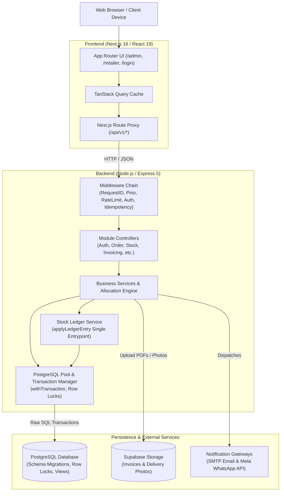

<!-- generated-by: gsd-doc-writer -->
# Architecture Overview

This document describes the architectural principles, component structure, data flows, and critical design invariants of KD-IOMS (KD Inventory & Order Management System).

## System Overview

KD-IOMS is a B2B pharmaceutical wholesale distribution and order management system built with a layered architecture inside an npm workspaces monorepo. It couples a TypeScript Node.js/Express REST API backend with a Next.js (App Router) React frontend, backed by a PostgreSQL database.

The system handles core wholesale pharmaceutical workflows including product and salt management, batch stock inwarding, real-time tiered catalog pricing, First-Expired, First-Out (FEFO) stock allocation, order state lifecycles, proof-of-delivery logging, and automated PDF tax invoicing. High concurrency and inventory consistency are guaranteed through strict database-level row locking and an append-only stock ledger.

## Component Diagram



## Data Flow

A typical mutating request (e.g., placing or approving an order) progresses through the following layers:

1. **Client Request**:
   The browser initiates a request to `/api/v1/...` which is transparently proxied by Next.js rewrites to the Express backend.
2. **Context & Tracing**:
   `requestIdMiddleware` generates or captures an `x-request-id` UUID header, binding it to asynchronous execution context using Node.js `AsyncLocalStorage`.
3. **Structured Logging**:
   `accessLogMiddleware` logs request start and finish events with method, route, status code, latency, and request ID via Pino.
4. **Security & Rate Limiting**:
   CORS rules validate the origin, and `generalLimiter` checks IP request thresholds (returning 429 if exceeded).
5. **Body Parsing & Idempotency**:
   JSON payloads are parsed with a 100kb payload limit. For mutating operations, `idempotency` middleware inspects `Idempotency-Key` headers against the `idempotency_keys` table to prevent duplicate execution.
6. **Authentication & Authorization**:
   `authenticate` verifies the JWT access token from the `Authorization: Bearer` header. Downstream middlewares (`authorize`, `requireApprovedRetailer`, `requirePasswordChanged`) verify user roles and account validity.
7. **Schema Validation**:
   Zod validation schemas validate URL parameters, query strings, and body contents. Any mismatch returns a structured `VALIDATION_ERROR` (400).
8. **Transactional Business Logic**:
   The service executes logic inside `withTransaction`:
   - Acquire row-level locks on affected entity rows (e.g., `lockMedicines` or `lockBatches`) sorted in ascending primary key order to prevent deadlocks.
   - Run domain validation (e.g., verifying batch status, stock availability, and expiry bounds).
   - Execute stock adjustments exclusively via `applyLedgerEntry`, which updates the batch balance and appends an immutable record to `stock_ledger`.
   - Commit the transaction. If PostgreSQL raises retryable serialization or deadlock errors (`40001` or `40P01`), `withTransaction` retries the block up to 2 times.
9. **Unified Response Formatting**:
   The controller wraps successful outcomes using `ok`, `created`, or `okList`, attaching `{ success: true, code, message, data, meta: { requestId, timestamp } }`.
10. **Error Trapping**:
   Uncaught errors are captured by `errorHandlerMiddleware`, normalized into `AppError` instances, logged with context, and returned with HTTP status code and standard error envelope.

## Key Abstractions

| Abstraction | Location | Purpose |
| :--- | :--- | :--- |
| `withTransaction` | `backend/src/config/db.ts` | Wraps database queries in `BEGIN`/`COMMIT`/`ROLLBACK` blocks with automatic retry logic for transient PostgreSQL deadlock errors (`40001`, `40P01`). |
| `lockMedicines` & `lockBatches` | `backend/src/config/db.ts` | Acquires `FOR UPDATE` row locks on IDs sorted strictly in ascending numeric order to guarantee deadlock-free concurrent order allocations and stock updates. |
| `applyLedgerEntry` | `backend/src/modules/stock-ledger/stock-ledger.service.ts` | The single canonical entry point for all inventory adjustments. Enforces atomic batch quantity mutations while appending immutable ledger audit entries. |
| `AppError` & `ERROR_CODES` | `backend/src/errors/app-error.ts`, `backend/src/constants/error-codes.ts` | Unified domain error representation carrying application-specific machine codes, HTTP statuses, and field-level error details. |
| Response Envelopes (`ok`, `created`, `okList`, `fail`) | `backend/src/utils/response.ts` | Enforces a standardized API response shape across all endpoints, automatically injecting `requestId` and timestamps. |
| `idempotency` Middleware | `backend/src/middleware/idempotency.ts` | Caches mutating response payloads keyed by header-supplied idempotency tokens to guarantee at-most-once execution for financial and order transitions. |
| Auth Middleware Pipeline | `backend/src/middleware/` | Composable access checks: `authenticate` (JWT extraction), `authorize` (role checking), `requireApprovedRetailer` (account verification), and `requirePasswordChanged` (initial credential rotation enforcement). |
| Next.js API Rewrites | `frontend/next.config.ts` | Internal URL proxying that forwards `/api/v1/*` requests directly to the Express backend without exposing internal network URLs or requiring cross-origin cookie policies. |

## Design Invariants

KD-IOMS maintains several fundamental design invariants to preserve business integrity:

1. **Single Entrypoint for Stock Mutation**:
   Batch inventory counts (`batches.quantity_on_hand`) must never be modified directly via ad-hoc SQL `UPDATE` queries. All adjustments must pass through `applyLedgerEntry` to preserve ledger consistency.
2. **Ascending Lock Acquisition Order**:
   Whenever multiple medicines or batches are locked in a single transaction, IDs are deduplicated and sorted in ascending order (`ORDER BY medicine_id ASC`) to mathematically eliminate cyclical wait-for graph deadlocks.
3. **FEFO Allocation Priority**:
   When orders are allocated or picked, inventory is consumed from the earliest expiring available batch (`expiry_date ASC`) that is not expired, not blocked, and retains available shelf life.
4. **Idempotent Mutations**:
   All financial and stock-decrementing endpoints (order placement, stock inwarding, order approval, picking, delivery completion) support idempotency keys to safeguard against network timeouts and duplicate user submissions.

## Directory Structure Rationale

The project is structured as an npm monorepo to maintain strong separation between server-side business rules and client-side presentation, while sharing TypeScript types and constants:

```
kd-ioms/
├── .github/              # Continuous integration workflows (GitHub Actions)
├── docs/                 # Canonical project architecture, API, and setup documentation
├── backend/              # Node.js / Express API service
│   ├── migrations/       # Sequential raw SQL schema migration scripts
│   ├── src/
│   │   ├── config/       # Environment parsing, database connection pool, logger
│   │   ├── constants/    # Error codes, system limits, domain constants
│   │   ├── enums/        # Business enums (order status, payment mode, user roles)
│   │   ├── errors/       # AppError hierarchy and database error mappers
│   │   ├── middleware/   # Request-id, auth, rate-limit, idempotency, error handlers
│   │   ├── modules/      # Domain modules (auth, order, stock, invoice, delivery, etc.)
│   │   ├── types/        # TypeScript request/response contracts and models
│   │   ├── utils/        # Context helpers, response formatters, encryption utilities
│   │   ├── app.ts        # Express app configuration and middleware pipeline
│   │   └── server.ts     # HTTP server entrypoint and graceful shutdown listeners
│   └── vitest.config.ts  # Backend Vitest configuration
├── frontend/             # Next.js 16 App Router web application
│   ├── public/           # Static web assets
│   ├── scripts/          # Enum synchronization utilities
│   ├── src/
│   │   ├── app/          # Next.js route handlers and page components
│   │   ├── components/   # Reusable UI widgets and domain components
│   │   ├── contexts/     # React state providers (Auth, Theme, Notifications)
│   │   ├── hooks/        # React Query custom hooks and utility hooks
│   │   ├── lib/          # API client and client-side helpers
│   │   └── types/        # Synced domain enums and client type definitions
│   ├── next.config.ts    # Next.js build config, Turbopack rules, and backend rewrites
│   └── vitest.config.ts  # Frontend Vitest configuration with jsdom
├── package.json          # Monorepo workspaces manifest and unified scripts
└── tech.md               # User-authored technical specification
```
