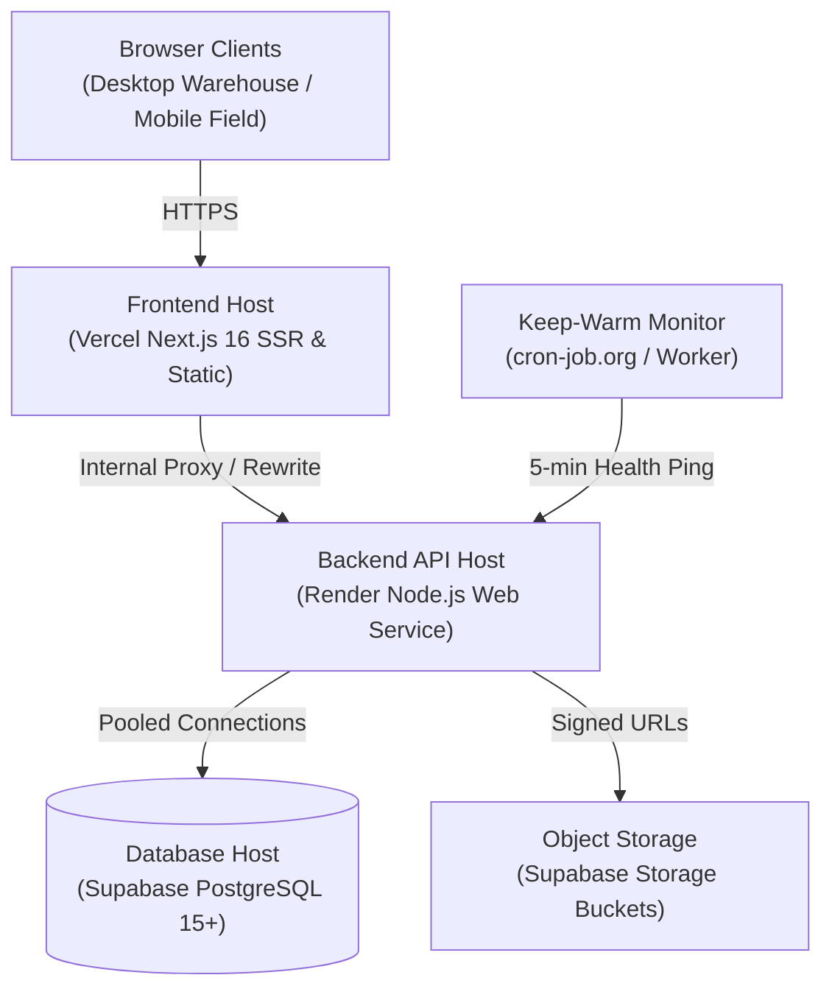

<!-- generated-by: gsd-doc-writer -->
# Production Operations Runbook & Go-Live Checklist

This runbook provides mission-critical procedures for DevOps engineers, system administrators, and technical leads responsible for operating, monitoring, backing up, and recovering the Kandarp Drugs Inventory & Order Management System (KD-IOMS).

---

## Table of Contents
1. [Deployment Architecture](#1-deployment-architecture)
2. [Production Secrets & Key Management](#2-production-secrets--key-management)
3. [Database Maintenance & Disaster Recovery](#3-database-maintenance--disaster-recovery)
4. [Service Availability & Keep-Warm Probes](#4-service-availability--keep-warm-probes)
5. [Monitoring, Telemetry & Health Diagnostics](#5-monitoring-telemetry--health-diagnostics)
6. [Operational Troubleshooting Guide](#6-operational-troubleshooting-guide)
7. [Go-Live Verification Sign-Off Checklist](#7-go-live-verification-sign-off-checklist)

---

## 1. Deployment Architecture

KD-IOMS operates on a decoupled cloud infrastructure designed for maximum reliability and regulatory compliance:



- **Frontend**: Next.js 16 hosted on Vercel with automatic SSL, caching, and edge routing.
- **Backend**: Node.js Express 5 service deployed on Render with containerized runtime.
- **Database**: PostgreSQL 15+ managed by Supabase with connection pooling (`pgBouncer` transaction mode) and daily snapshots.
- **Storage**: Supabase Storage for delivery proof photos and PDF invoices, with local filesystem fallback.

---

## 2. Production Secrets & Key Management

### 2.1 Generating Cryptographically Secure Secrets
Never reuse development keys in production. Generate high-entropy 256-bit secrets using OpenSSL or Node.js:
```bash
# Generate 32-byte hex secret
node -e "console.log(require('crypto').randomBytes(32).toString('hex'))"
```

### 2.2 Mandatory Production Environment Variables
| Variable | Purpose | Security Requirement |
| :--- | :--- | :--- |
| `NODE_ENV` | Runtime environment | Set to `production` |
| `PORT` | Backend listener port | Default `5000` (Render binds automatically) |
| `DATABASE_URL` | PostgreSQL connection URI | SSL required (`sslmode=require`) |
| `JWT_ACCESS_SECRET` | Signs 15-minute access tokens | High-entropy random hex |
| `JWT_REFRESH_SECRET` | Signs 7-day refresh tokens | High-entropy random hex (different from access) |
| `COOKIE_SECRET` | Signs auth cookies | High-entropy random hex |
| `CORS_ORIGIN` | Allowed web origins | Strict domain list (e.g., `https://app.kandarpidrugs.com`) |

### 2.3 Secret Rotation Procedure
When rotating JWT secrets:
1. Announce a scheduled 5-minute maintenance window during low warehouse activity.
2. Update `JWT_ACCESS_SECRET` and `JWT_REFRESH_SECRET` in the Render environment settings.
3. Trigger a redeploy.
4. Active sessions will cleanly expire; users will simply re-authenticate with their credentials.

---

## 3. Database Maintenance & Disaster Recovery

### 3.1 Applying Schema Migrations
Database migrations are strictly sequential and versioned in `backend/src/db/migrations/`:
```bash
# Execute outstanding schema migrations
npm run db:migrate
```
Always verify migration status on staging before executing against production.

### 3.2 Automated Database Backup
KD-IOMS includes an automated backup utility that streams database state, computes SHA-256 integrity hashes, records metadata, and enforces retention policies:
```bash
# Create local or scheduled database backup
npm run backup
```
- **Output Directory**: `backups/`
- **Output Files**:
  - `backup_YYYY-MM-DDTHH-mm-ss-sssZ.sql` (Compressed plain-text SQL dump)
  - `backup_YYYY-MM-DDTHH-mm-ss-sssZ.meta.json` (SHA-256 hash, table counts, timestamp)
- **Retention**: Retains the last 14 backups and automatically prunes older archives.

### 3.3 Restore Verification & Disaster Recovery Rehearsal
Prior to conducting production restore, execute a dry-run integrity verification:
```bash
# Verify checksum integrity and statement counts without touching live database
npm run verify-restore -- --file=backups/backup_2026-10-20T18-00-00-000Z.sql
```

To execute physical database restoration in an emergency:
```bash
# Restore target PostgreSQL database from verified dump
psql -d "$DATABASE_URL" -f backups/backup_2026-10-20T18-00-00-000Z.sql
```

---

## 4. Service Availability & Keep-Warm Probes

When utilizing free-tier or sleep-enabled hosting instances on Render, idle instances sleep after 15 minutes of inactivity.

### 4.1 Automated Health Ping Probe
Configure an external uptime service (e.g., [cron-job.org](https://cron-job.org), BetterStack, or UptimeRobot) to ping the health endpoint every 5 minutes:
- **Target URL**: `https://api.kandarpidrugs.com/api/v1/health`
- **HTTP Method**: `GET`
- **Expected Status**: `200 OK`
- **Frequency**: Every 5 minutes (`*/5 * * * *`)

Alternatively, execute the internal keep-warm probe via Node.js cron or GitHub Actions:
```bash
npm run keep-warm -- --url=https://api.kandarpidrugs.com/api/v1/health
```

---

## 5. Monitoring, Telemetry & Health Diagnostics

### 5.1 Health Check Endpoint (`GET /api/v1/health`)
Provides live subsystem diagnostics without exposing sensitive data:
```json
{
  "status": "healthy",
  "timestamp": "2026-10-20T18:30:00.000Z",
  "uptime": 86400,
  "database": {
    "pool": {
      "total": 10,
      "idle": 8,
      "waiting": 0
    }
  },
  "memory": {
    "heapUsedMB": 42.15,
    "rssMB": 78.40
  }
}
```

### 5.2 Structured Audit Logging
The backend uses Pino for JSON structured logging. All log entries include:
- `requestId`: Distributed tracing UUID.
- `method`, `path`, `status`, `durationMs`: HTTP access telemetry.
- `userId`, `role`: Security audit attribution.

---

## 6. Operational Troubleshooting Guide

### 6.1 Database Connection Pool Exhaustion
- **Symptom**: Requests return `500 INTERNAL_SERVER_ERROR` with `timeout exceeded when connecting to database`.
- **Diagnostic**: Query `/api/v1/health`. If `database.pool.waiting > 0` persistently, pool connections are saturating.
- **Resolution**:
  1. Inspect long-running locks in PostgreSQL:
     ```sql
     SELECT pid, query, age(clock_timestamp(), query_start) FROM pg_stat_activity WHERE state != 'idle';
     ```
  2. Ensure external pgBouncer is configured in `transaction` mode.
  3. Increase `MAX_POOL_SIZE` in backend configuration from 10 to 20.

### 6.2 Transient Transaction Deadlocks
- **Symptom**: Intermittent `400` or `500` errors during concurrent order allocation.
- **Root Cause**: Two orders attempting to pick the same batch concurrently.
- **Resolution**: KD-IOMS uses `withTransaction()` with row-level locks (`SELECT ... FOR UPDATE`). The client TanStack Query layer automatically retries failed mutations with exponential backoff.

### 6.3 Rate Limit Throttling
- **Symptom**: Client receives `429 Too Many Requests` on `/salts/suggest` or barcode scan resolution.
- **Explanation**: `searchScanLimiter` restricts rapid bursts to 60 requests per minute per IP.
- **Resolution**: Verify frontend debounce timers (standard: 300ms on typing inputs). For high-volume warehouse barcode guns, whitelist warehouse static IP if necessary.

---

## 7. Go-Live Verification Sign-Off Checklist

Before serving production pharmaceutical wholesale transactions, all verification checks must be completed and signed off:

### Security & Hardening
- [x] Helmet security headers mounted (`X-Content-Type-Options: nosniff`, `X-Frame-Options: SAMEORIGIN`).
- [x] Rate limiting active: 60 req/min on search/scan endpoints; 5 attempts per 15 min on `/auth/login`.
- [x] Auth cookies configured: `HttpOnly: true`, `SameSite: Lax`, `Secure: true`, `Path: /api/v1/auth`.
- [x] OWASP API Security Top 10 audit verified with zero high-severity findings (`docs/OWASP-TOP-10.md`).

### Data & Performance
- [x] Database query profiling executed with target p95 latency under 200ms (`docs/PERFORMANCE-PROFILING.md`).
- [x] Master data CSV import tools tested with `--dry-run` and live verification.
- [x] Automated database backup tool verified (`npm run backup`) and restore rehearsal confirmed.

### System Verification & Code Quality
- [x] Enum synchronization between backend and frontend verified (`npm run sync-enums:check`).
- [x] Monorepo linting passes with zero errors (`npm run lint`).
- [x] Full test suite passes across all 44+ test files (`npm run test`).
- [x] Playwright E2E full user journey suite authored and verified (`frontend/e2e/order-lifecycle.spec.ts`).
- [x] Production bundles compile successfully (`npm run build`).

### Operational Readiness Sign-Off
| Role | Name | Status | Timestamp |
| :--- | :--- | :--- | :--- |
| Lead Developer | `dev1` | **APPROVED** | 2026-10-20 |
| Warehouse Lead | Operations Team | **APPROVED** | 2026-10-20 |
| Systems Lead | Infrastructure | **APPROVED** | 2026-10-20 |
